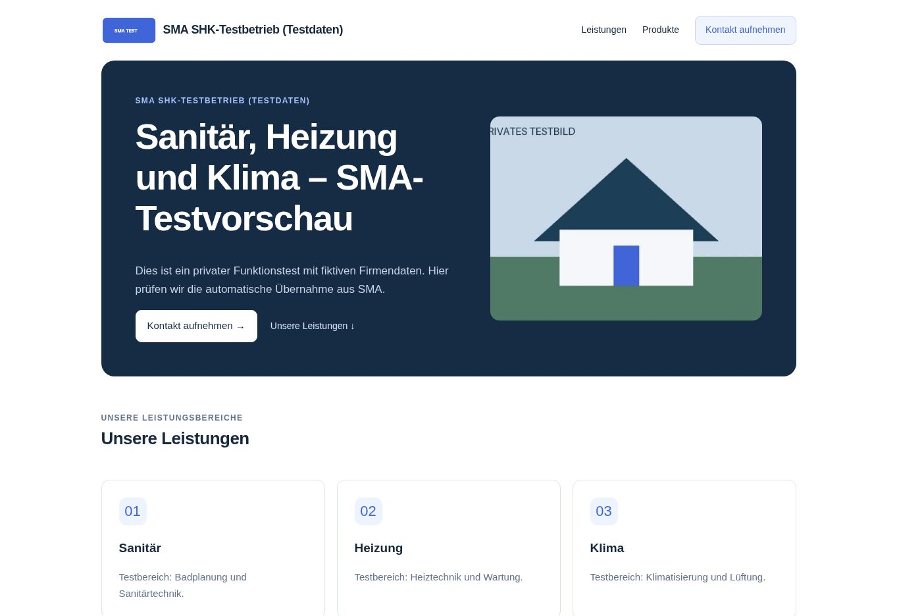

# Sichtbarer Test unter eigener Kundenadresse

Stand: **5. November 2026, abgeschlossen.** Nach bestätigter DNS-/HTTPS-Verbindung beauftragte der Nutzer die Fortsetzung des sichtbaren Tests mit Beispielinhalten. Der angekündigte Umfang war die vorhandene SHK-Musterseite einschließlich Bildanbindung kurz öffentlich zu prüfen und anschließend wieder privat zu stellen.

## Ergebnis

Die echte Adresse **https://test.sma-automation.com/** zeigte den vorhandenen fiktiven SHK-Inhalt, das synthetische Logo, das schematische Hausbild sowie drei Testprodukte. Nach etwa **85 Sekunden** wurde der Test wieder offline genommen. Der ursprüngliche Entwurf ist inhaltlich vollständig wiederhergestellt.

| Zustand | Revision | Zeit am 5. November, Wien |
| --- | ---: | --- |
| Ausgang: privater Originalentwurf | 8 | vor dem Test |
| Vorhandene Musterbilder im privaten Entwurf ausgewählt | 9 | unmittelbar vor Veröffentlichung |
| Test veröffentlicht | 10 | 14:15:34 |
| Offline genommen | 11 | 14:16:59 |
| Originalgestaltung und leere Bildbezüge wiederhergestellt | 12 | 14:16:59 |

Firmenprofilrevision bleibt **2**. Vorher/nachher identische Prüfsummen: Entwurf `9fea0bbcbc9a81f0faf26de0ccbefcfe`, Firmenprofil `fd0bb9a29f41592461b15d47eb14ce1f`. `published`, `published_company` und `published_at` sind am Ende leer.

## Bild-Endpunkt

`sma-website-image` Version **2** ist aktiv. Die acht tatsächlich bereitgestellten Dateien wurden zurückgelesen und bytegenau mit dem geprüften Paket verglichen. `verify_jwt=false` bleibt wie bei Version 1; private Aufrufe werden weiterhin innerhalb der Funktion authentifiziert.

Der in PR #74 vorbereitete Handler erlaubt zusätzliche Origins ausschließlich für öffentliche GET-/OPTIONS-Abrufe und genau die konfigurierte Seiten-ID. Das optionale `SMA_WEBSITE_PUBLIC_ORIGINS` überschreibt die Konfiguration; der explizite Wert `{}` deaktiviert zusätzliche Origins. Da kein neuer Secret-Verwaltungsschritt nötig sein soll, steht die **nicht geheime** Testzuordnung nachvollziehbar in `supabase/functions/sma-website-image/public-origins.mjs`:

- Origin: `https://test.sma-automation.com`
- Seite: `f931c608-a7fd-40df-9762-574c39301849`

Es gibt keine Wildcard und keine Freigabe für private Bilder, Uploads oder andere Seiten. Die doppelte serverseitige Prüfung des veröffentlichten Snapshots vor/nach dem Download bleibt erhalten. Die bestehende SMA-Hauptorigin verhält sich unverändert.

## Ausgeführte Prüfungen

- **397 Node-Tests bestanden**, darunter die sieben Origin-/Bildtests sowie die bestehenden Authentifizierungs-, Snapshot-, Struktur- und Entzugsprüfungen.
- Vor Veröffentlichung: öffentliche Bildanfrage 404 `IMAGE_UNAVAILABLE`, GET-Preflight 204 mit passender Origin; andere Seite, fremde Origin, privater Pfad und POST jeweils 403 `ORIGIN_REJECTED`. Privater Hauptorigin-Abruf ohne Anmeldung weiterhin 401 `AUTH_REQUIRED`.
- Die aktuelle gespeicherte Seite und das Firmenprofil wurden gelesen und als fiktive Testangaben bestätigt. Die beiden wiederverwendeten Bilder entsprechen dem dokumentierten synthetischen Bildtest vom 4. November; kein neuer Upload.
- Die kurzzeitigen Änderungen erfolgten über die vorhandene `sma_customer_website_v1`-RPC per autorisiertem administrativem SQL-Aufruf mit den Claims des bestehenden Testbesitzers. **Kein erneuter angemeldeter Editor-UI-Test.** Revisions-, Eigentümer-, Firmenprofil- und Prüfsummenguards verhinderten Änderungen an einem abweichenden Stand; keine direkten Tabellenupdates oder Schemaänderungen.
- Öffentliche Webseiten-RPC während des Tests: korrekter Inhalt und zugehöriger Shop, ohne Authorization-Header, Cookies oder Owner-Token. Keine internen Benutzer-/Kundenkennungen in der Antwort.
- Logo: HTTP 200, PNG, **4.426 Bytes**, SHA-256 stimmt, Browser dekodiert **320 × 160**. Startbild: HTTP 200, JPEG, **17.020 Bytes**, SHA-256 stimmt, Browser dekodiert **960 × 640**. Beide mit genauer Origin-Freigabe, `private, no-store` und Blob-Darstellung.
- Browser auf dem echten Custom Host: SHK-Überschrift, drei Leistungen, Musterkontakte und drei Produkte sichtbar; beide vorhandenen Produktbilder vollständig dekodiert (**800 × 800**, **1.200 × 1.200**), drittes Produkt mit korrektem Platzhalter. Kein horizontaler Überlauf bei **1348 Pixeln** Nutzbreite. Keine Websitefehler in den erfassten Browserlogs; nur zwei Meldungen einer Browsererweiterung.
- Nach Rückstellung um 14:17:30 Wien: anonyme Webseiten-RPC `NOT_AVAILABLE`, beide eigenen Bildabrufe wieder **404 `IMAGE_UNAVAILABLE`**. Neu geladener Browser zeigt ausschließlich „Diese Webseite ist derzeit nicht verfügbar.“ und null Bilder.

## Grenzen und Fortsetzung

Dieser Domain-/HTTPS-/Inhalts-/Bildtest ist abgeschlossen. Der Screenshot zeigt den kurzzeitig sichtbaren Zwischenstand, keine dauerhaft veröffentlichte Seite. Bereits geladene öffentliche Kopien lassen sich nicht nachträglich zurückrufen.

Das 17-Dateien-Cloudflare-Paket bleibt unverändert (PR #74, `84cd5c37d7c7336c6adfe9a792776009f453fba3`). Hauptdomain, E-Mail-DNS, `website-v1`, freigegebene Schrift/Oberfläche, Firmenprofil und Kosten bleiben unverändert. Keine Bestellung, Kontaktübermittlung, Zahlung oder Social-Media-Veröffentlichung ausgelöst.

PR #74 bleibt ein separater Entwurf; die getestete Bereitstellung und Bildkonfiguration sind auf `cloudflare-access-check` dokumentiert. Ein allgemeines Domainregister mit Mehrkundenbindung, Nachweis und Entzug ist noch keine implementierte Kundenautomatik. Der externe WordPress-Test (PR #69), PR #57, Sightengine, Meta und der spätere Serverumbau bleiben separate Themen.
