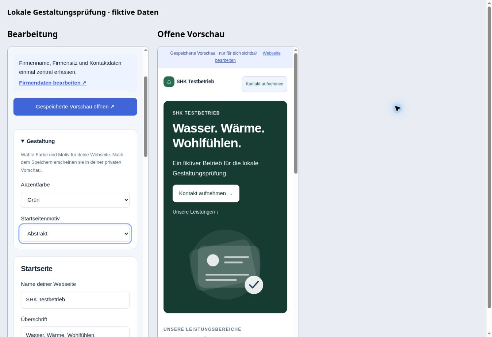
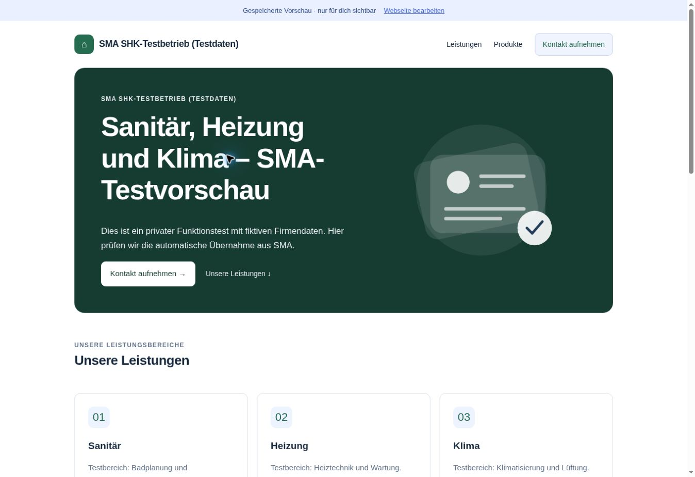

# Individuelle Gestaltung der SMA-Kundenwebseite

Stand: 4. November 2026. Ausgangspunkt ist `website-v1` nach dem zusammengeführten und live geprüften PR #70 (`6de7a26`). Die abgeschlossene Profilpflege und automatische Vorschauaktualisierung werden weiterverwendet. Die Gestaltung wurde mit Freigabe des Nutzers über **PR #71 zusammengeführt und live bereitgestellt**. Datenbankmigration und angemeldeter privater Speichertest sind abgeschlossen; Einzelheiten unter „Live-Abnahme“.

## Nächster Kundenschritt

Der bisherige Editor kann Texte und gemeinsame Firmendaten übernehmen, bietet aber für alle Betriebe dieselbe blaue Darstellung mit SHK-Hausmotiv. Unter **Webseite bearbeiten → Gestaltung** kann der Kunde jetzt wählen:

| Einstellung | Auswahl |
| --- | --- |
| Akzentfarbe | Blau, Grün, Violett, Terrakotta |
| Startseitenmotiv | Haus & Technik, Abstrakt, Ohne Motiv |

Der Bereich ist zunächst zugeklappt. Geöffnet erscheinen zwei kurze Auswahlfelder, auf dem Handy untereinander. Die vorhandene Schrift, Texteingaben und kompakte Dashboard-Übersicht bleiben erhalten. Der Editor selbst behält die SMA-Farbe; die gewählte Farbe gilt für die Kundenwebseite.

**Änderungen speichern** speichert Texte und Gestaltung gemeinsam im privaten Entwurf. Die offene private Vorschau übernimmt den gespeicherten Stand beim Zurückwechseln über die vorhandene Funktion aus PR #70. Ein öffentliches Angebot bleibt beim ausdrücklich veröffentlichten Snapshot. Die bestehende Aktion zum Veröffentlichen übernimmt später auch die gewählte Gestaltung; dieser Schritt wurde ausschließlich mit isolierten SQL-Testdaten geprüft.

Bestehende Entwürfe und veröffentlichte Seiten ohne Gestaltungsfelder erscheinen weiterhin in Blau mit Hausmotiv. Neue freie CSS-, HTML-, URL- oder Bild-Uploadfelder werden nicht eingeführt. Eigene Fotos/Logos und individuelle Domains bleiben gesonderte Erweiterungen.

## Speicherung und Bereitstellung

Die vorhandenen JSON-Inhalte erhalten zwei optionale, streng begrenzte Zeichenketten: `accent` und `hero`. JavaScript und die bestehende SQL-Inhaltsprüfung akzeptieren ausschließlich die oben aufgeführten Werte. Keine neue Tabelle, keine neuen Rechte oder externen Abrufe. Profilübernahme, Revisionen, Wiederholung und Besitzerprüfung bleiben auf dem vorhandenen Weg.

Ältere Schreibanfragen ohne Gestaltungsfelder erhalten bereits gespeicherte Werte. Die neue Oberfläche liest auch alte Inhalte. Alte, bereits geöffnete Browserseiten müssen bei Bereitstellung neu geladen werden, da deren bisherige Inhaltsprüfung zusätzliche Felder noch nicht kennt. Die geänderten HTML-Einstiege und ihre Modul-/Stylesheet-Abhängigkeiten erhalten neue Cache-Versionen.

**Ausgeführte Bereitstellungsreihenfolge (nach Freigabe):**

1. Die aktualisierte Fassung von `supabase/sql/customer-websites.sql` im bestehenden Projekt bereitstellen. Die Änderungen betreffen die Inhaltsvalidierung und die Beibehaltung optionaler Gestaltungsfelder bei älteren Schreibanfragen. Kein Kundeninhalt wird durch das Installationsskript geändert.
2. Den PR in `website-v1` übernehmen und die Oberflächenbereitstellung prüfen. Die neue Oberfläche darf nicht vor dem SQL-Update ausgeliefert werden, da der alte Validator Gestaltungsfelder ablehnt.
3. Den angemeldeten privaten Ablauf prüfen. Der vorhandene fiktive SHK-Entwurf bleibt privat; keine öffentliche Kundenwebseite wird dafür benötigt.

Nach Speicherung neuer Felder nicht allein die alte, strengere JavaScript-/SQL-Version zurückrollen: Diese kann neue Inhalte nicht lesen beziehungsweise akzeptieren. Eine Korrektur muss die optionalen Felder weiter unterstützen. Vor einer späteren Veröffentlichung bleiben echte Firmendaten und Seitenangaben eine eigene Kundenentscheidung.

## Nachweise

- **362 Node-Tests bestanden** (359 bestehende plus drei neue): optionale Felder, alle zwölf Kombinationen, Ablehnung freier CSS-/URL-/HTML-Werte und Wiederholung eines unterbrochenen Speichervorgangs.
- **Sieben neue DOM-Szenarien bestanden:** bisherige Darstellung, zwölf Renderkombinationen, kompakter Einstieg, Speichern/Wiederaufruf, Fehler/Wiederholung, Übernahme in die offene private Vorschau bei unverändertem öffentlichen Snapshot und Leeren beim Kontowechsel.
- Lokales PostgreSQL über PGlite: Inhaltsgrenzen, dauerhafte Speicherung innerhalb der Testdatenbank, Wiederholung, ältere Schreibanfragen, Revisionskonflikt sowie getrennte private/öffentliche Gestaltung und Offline-Schaltung. Alle Fixtures zurückgerollt. Bestehende Webseiten-/Profil-SQL-Prüfungen einschließlich Rollen und Direktrechten bestanden ebenfalls.
- Bestehende Webseiten-/Firmenprofil-/WordPress-/WordPress-Sync-DOM-Prüfungen und die zwölf Vorschauaktualisierungs-Szenarien bestanden. `git diff --check` sauber.
- Browserlauf mit den tatsächlichen Editor-/Modell-/Vorschau-/Renderer-Modulen, fiktiven Daten und simuliertem Speicherweg im lokalen Browserspeicher: Grün + Abstrakt speichern, Fokus zur bereits offenen Vorschau wechseln, geänderte Darstellung sichtbar. Danach Terrakotta + Ohne Motiv speichern, Vorschau ohne SVG und wieder geöffnete Desktopansicht bestätigt.
- Zwei 390-Pixel-Handyrahmen: jeweils 375 Pixel nutzbare Breite und 375 Pixel Inhaltsbreite. Desktopansicht: 1348 Pixel nutzbare Breite und Inhaltsbreite. Kein horizontaler Überlauf. Kein neuer angemeldeter Supabase-Livetest und keine reale Veröffentlichung aus dieser Browserprüfung abzuleiten.



```sh
node --test tests/*.test.cjs
node tests/run-customer-websites-sql.mjs
node tests/run-customer-website-design-dom.mjs
node tests/run-customer-website-dom.mjs
node tests/run-customer-website-refresh-dom.mjs
node tests/run-company-profile-dom.mjs
node tests/run-wordpress-dom.mjs
node tests/run-wordpress-sync-dom.mjs
```

Die obigen lokalen Prüfungen veränderten keine Produktionsdaten. Die anschließend freigegebene Bereitstellung und die zwei privaten Test-Speichervorgänge sind unten dokumentiert. Keine Kundenwebseite veröffentlicht, kein Hosting gebucht und keine DNS-/Tarifänderung ausgeführt. PR #69 bleibt als lokaler WordPress-Praxistest separat offen; keine externe Testadresse vorhanden und weiterhin nur Produktbereich, keine Firmenprofiltexte. PR #57 bleibt separat. Sightengine: `VIDEO_PLAN_REQUIRED`; Meta und Serverumbau bleiben zurückgestellt.

## Live-Abnahme

Am 4. November 2026 hat der Nutzer die Bereitstellung von PR #71 einschließlich der Datenbankanpassung freigegeben.

- Die beiden geänderten Live-Funktionen stimmten vor der Installation mit der geprüften Ausgangsfassung überein. Migration **`20261104164513_customer_website_design_v1`** installiert. Der Vorher-/Nachher-Abgleich bestätigte eine unveränderte gespeicherte Webseitenzeile und weiterhin null veröffentlichte Seiten.
- Native SQL-Prüfung: alle zwölf Farb-/Motivkombinationen akzeptiert, ungültige Werte abgewiesen, sitzungsloser Zugriff `AUTH_REQUIRED`, anonyme private RPC und direkte Tabellenleserechte weiterhin gesperrt, RLS aktiv. Der Webseiten-Advisor meldet weiterhin nur das beabsichtigte [INFO für RLS ohne Direktzugriff](https://supabase.com/docs/guides/database/database-linter?lint=0008_rls_enabled_no_policy). Weitere projektweite Hinweise betreffen unveränderte andere Funktionen und die Auth-Konfiguration; sie wurden nicht als Teil dieser Gestaltung geändert.
- PR #71 mit Commit `c7d58db29f3ba43b60d5ed5670eb8bed5c1fdc4c` zusammengeführt. [GitHub-Pages-Auslieferung 41870689790](https://github.com/sma-automation/sma-automation.github.io/actions/runs/41870689790) erfolgreich. Der ausgelieferte Editor sowie Modell-, Renderer- und Editor-Modul stimmen bytegenau mit der freigegebenen Fassung überein.
- Die vorhandene angemeldete SMA-Kundensitzung geöffnet. Der fiktive SHK-Entwurf erschien mit den bestehenden Texten, zentralen Firmendaten und zugeordnetem Testshop. Im Gestaltungsbereich **Grün + Abstrakt** gewählt und über **Änderungen speichern** gespeichert. Die Oberfläche bestätigte „Bereit.“; die native lesende Prüfung bestätigte Webseitenrevision 3 und die gespeicherten Werte.
- Die private Live-Vorschau zeigte nach erneutem Laden die grüne Gestaltung mit abstraktem Motiv, bestehende Texte und drei Testprodukte. Es wurden echte reguläre Kundenaufrufe verwendet, keine simulierte Antwort und keine direkte Datenbankänderung am Entwurf.
- Der automatische Fokuswechsel zwischen zwei eigenständigen Tabs wurde durch diesen Browserlauf nicht zusätzlich nachgewiesen: Die Browsersteuerung löste beim Ansprechen des anderen Tabs keine beobachtete Aktualisierung aus; deshalb erfolgte der belegte Live-Abruf durch Neuladen. Die bereits abgenommene PR-#70-Funktion sowie die lokalen Fokus-/Sichtbarkeitsprüfungen bleiben der gesonderte Nachweis.
- Anschließend **Blau + Haus & Technik** wieder über den Editor gespeichert. Endstand **Revision 4**, `accent=blue`, `hero=shk`. Genau eine Webseite; `published`, `published_company` und `published_at` weiterhin leer; öffentliche RPC antwortet `NOT_AVAILABLE`. Keine Firmenprofilfelder bearbeitet. Der normale Website-Speicherweg übernimmt wie vorgesehen die bereits aktuellen gemeinsamen Firmendaten.



Der private SHK-Testentwurf bleibt gespeichert. PR #69 und PR #57 bleiben separat offen. Nächster möglicher Kundenschritt: eigene Firmenlogos und Bilder für SMA-Webseiten; das ist noch nicht implementiert und nicht Teil dieser Veröffentlichung.
