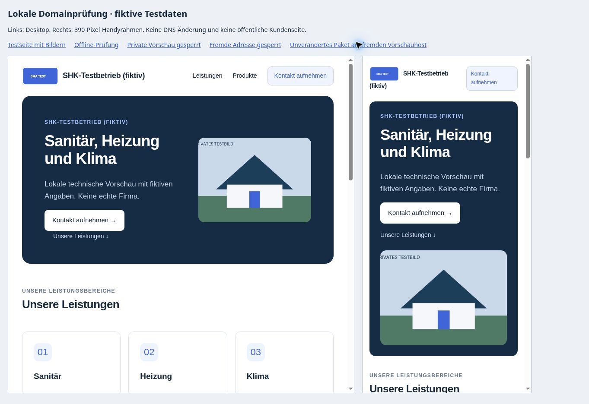

# Lokales Testpaket für die eigene Kundenadresse

> Fortschreibung 5. November: Der unten beschriebene Vorbereitungsstand ist historisch. [Domain-/HTTPS-/Inhaltstest abgeschlossen](CUSTOMER_WEBSITE_CUSTOM_DOMAIN_E2E.md); [bestätigte Adresse im Kundeneditor](CUSTOMER_WEBSITE_ADDRESSES.md).

Stand: **4. November 2026. Implementiert und lokal geprüft, nicht zusammengeführt oder bereitgestellt.** Die [Machbarkeitsprüfung](CUSTOMER_WEBSITE_DOMAIN_HOSTING.md) wird damit um das konkret baubare Testpaket ergänzt.

## Ergebnis

- Ein reproduzierbarer Build erzeugt 17 statische Dateien für genau eine konfigurierte HTTPS-Adresse und Seiten-ID. Der lokale Prüfbuild für `test.sma-automation.com` und den vorhandenen SHK-Entwurf umfasst **52.105 Bytes**. Er enthält keine gespeicherten Firmeninhalte oder Bilddateien; diese werden ausschließlich über die öffentlichen Schnittstellen des veröffentlichten Standes geladen.
- Der Root-Aufruf wird intern der festen Seiten-ID zugeordnet. Fremde Hosts, andere Pfade, eingegebene Seiten-IDs und private Vorschauparameter lösen keine Seitenabfrage aus. Es gibt keine Anmeldung auf dem Kundenhost.
- Vorhandener Seitenrenderer, Schrift, Farben, responsive Darstellung und Produktanzeige werden übernommen. Das Stylesheet ist bytegleich mit dem bestehenden Stand (SHA-256 `562c33305d85f9906ba17300f27e249e68793217db3cf1157dd67dd871c5cc4f`). Dashboard und Editor wurden nicht verändert.
- Der Bild-Endpunkt kann künftig über eine gesonderte, standardmäßig leere Konfiguration einzelne Origins an genau eine öffentliche Seite binden. Zusätzliche Origins erhalten ausschließlich öffentliche Bildlesezugriffe; Uploads und private Zugriffe bleiben dort gesperrt. Die bestehende doppelte Snapshotprüfung vor/nach dem Download bleibt erhalten.
- Statische 404-Seite, keine Auth-Bibliothek im Paket, Browser-/API-Abrufe ohne Cookies oder Owner-Token, keine Schreib- oder Kaufoperation im neuen Frontend. Die gemeinsame Modell-/Darstellungslogik wird weiterverwendet; private Wege werden vom Einstieg nicht angeboten oder aufgerufen.

## Prüfungen

**397 Node-Tests bestanden**: 383 vorhandene und 14 zusätzliche Prüfungen für Hostbindung, Paketgrenze, öffentliche Transporte sowie Origin-/Seitenbindung der Bilder. **Acht neue DOM-Szenarien bestanden**, außerdem die zwölf bestehenden Vorschau-Aktualisierungs- und zehn Bild-DOM-Szenarien.

Die neuen Nachweise umfassen insbesondere abweichende Hosts/Ports, private oder fremde Queryparameter, ungültige Konfigurationen, vollständige lokale Modulabhängigkeiten, unverändertes CSS, fehlenden Auth-Client, öffentliche Abrufe ohne Anmeldung, korrekte Preflights, verweigerte private Bildoperationen, Offline-/Berechtigungsentzug während eines Downloads und verspätete Antworten nach dem Schließen einer Seite.

```sh
node --test tests/*.test.cjs
node tests/run-customer-website-domain-dom.mjs
node tests/run-customer-website-refresh-dom.mjs
node tests/run-customer-website-images-dom.mjs
git diff --check
```

Die bestehende SQL-/RLS-Schicht wurde nicht verändert; daher keine Migration oder erneute Live-Datenbank-Fixture. Der frühere öffentliche Veröffentlichungs-/Offline-Test wird nicht wiederholt.

### Lokaler Browser

Die Prüfung nutzte dieselben Oberflächenmodule und das unveränderte Stylesheet, jedoch **synthetische öffentliche Antworten und lokale Bildfixtures**. Desktop mit 785 Pixel Nutzbreite und 390-Pixel-Handyrahmen mit 375 Pixel Nutzbreite: jeweils kein horizontaler Überlauf. Logo (320 × 160), Startbild (960 × 640) und Produktbild vollständig geladen. Offline-Antwort zeigte „Diese Webseite ist derzeit nicht verfügbar“; private Vorschau und fremder Host führten zu derselben Meldung ohne Seitenabfrage. Das unveränderte gebaute Paket blieb am abweichenden lokalen Vorschauhost erwartungsgemäß gesperrt.



### Lesender Abgleich der bestehenden öffentlichen Schnittstellen

HTTP-Anfragen mit `Origin: https://test.sma-automation.com`, ohne Owner-Anmeldung:

| Schnittstelle | Antwort des unveränderten Live-Systems |
| --- | --- |
| Öffentlicher Produktkatalog, GET | 200; `Access-Control-Allow-Origin: *`. |
| Öffentliche Webseiten-RPC, OPTIONS für POST mit `apikey,content-type` | 200; passende CORS-Header. |
| Eigene Webseitenbilder, OPTIONS für GET mit `apikey` | 403 ohne Origin-Freigabe; erwarteter aktueller Zustand. |

Diese Headerprüfung ersetzt keinen Browseraufruf über die noch nicht eingerichtete Testdomain. Sie bestätigt, welche bestehende Schnittstelle für den Test noch angepasst werden muss. Keine öffentliche Kundenseite wurde dadurch freigeschaltet.

## Fortsetzung

Die lokale Vorbereitung ist abgeschlossen. [Build und konkrete Bereitstellungsreihenfolge](../hosting/customer-website/README.md) sind dokumentiert. Offen bleiben der geeignete Cloudflare-Zugang, die Freigabe und Ausführung der Bereitstellung, der IONOS-CNAME, reales HTTPS sowie ein ausdrücklich freigegebener öffentlicher Bild-/Domainlauf. Diese Freigabe wurde nicht aus „weiter“ abgeleitet. Die Zuordnung im statischen Paket und im Bild-Endpunkt ist ein begrenzter Testweg; ein allgemeines serverseitiges Domainregister mit Nachweis-/Entzugslebenszyklus bleibt spätere Mehrkundenarbeit.

Der gespeicherte SHK-Entwurf wurde weder geladen noch geschrieben oder veröffentlicht; letzter bestätigter Stand bleibt privat, Revision 8. PR #69 wurde lesend abgeglichen und bleibt separat offen: lokaler WordPress-Test bestanden, externe Testseite fehlt, nur Produktbereich. PR #57 unverändert. Keine Buchung, kein neuer Account, kein DNS-Eintrag, keine Änderung am bestehenden `CNAME`, keine Edge-/Datenbankbereitstellung. Sightengine `VIDEO_PLAN_REQUIRED`, Meta und Serverumbau bleiben zurückgestellt.
