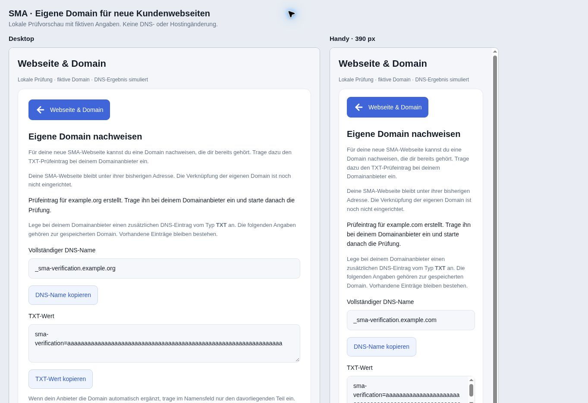

# Eigene Domain für neue SMA-Webseiten nachweisen

Stand: 4. November 2026. **Implementiert und lokal geprüft; noch nicht bereitgestellt.** Ziel `website-v1`. PR #70, #71 und #72 sind bereits live und abgeschlossen. Der vorhandene private SHK-Entwurf bleibt unverändert bei Revision 6.

## Geschlossene Lücke und Kundenablauf

Der vorhandene Domainnachweis war auf gespeicherte bestehende Webseiten beschränkt. Beim Weg „Ich benötige eine Webseite“ war der Nachweis bisher deaktiviert. Die Erweiterung verwendet dort die gespeicherte eigene Domain aus dem vorhandenen optionalen Domainfeld.

1. „Webseite & Domain“ → „Webseite einrichten“ → „Ich benötige eine Webseite“ auswählen.
2. Eine bereits selbst verwaltete Domain hinterlegen und **Vorbereitung speichern**. Ohne Domain bleibt die Erstellung der SMA-Webseite möglich; ein bloßer Wunsch reserviert oder kauft keine Domain.
3. **Eigene Domain nachweisen** öffnet die vorhandene separate Ansicht. **Prüfeintrag erstellen** erzeugt den kundengebundenen TXT-Wert. Das Laden der Ansicht startet keine DNS-Abfrage und legt keinen Nachweis an.
4. Der Kunde setzt den zusätzlichen TXT-Eintrag bei seinem Domainanbieter. Erst **Domainnachweis prüfen** fragt den bestehenden DNS-Dienst ab.
5. Ein Erfolg belegt die DNS-Kontrolle zum angegebenen Zeitpunkt. Die Oberfläche weist ausdrücklich darauf hin, dass die eigene Domain noch nicht mit der SMA-Webseite verknüpft ist.

Die Übersicht behält drei Einträge. Im bestehenden Erstellungsbereich kommt ein Direktbutton zur Domainansicht hinzu. Das Stylesheet bleibt unverändert; Schrift und kompakte Arbeitsansichten werden übernommen.

Bei vorhandenen externen Webseiten wird weiterhin ausschließlich der Host der gespeicherten HTTPS-Webadresse geprüft; eine daneben eingetragene Wunschdomain ändert dieses Ziel nicht. Eine neue SMA-Domain schaltet weder die WordPress-Verbindung noch einen Produktauftrag frei.

## Bindung und Schutz

- Browseranfragen enthalten weiterhin nur `get`, `prepare` oder `verify`. Hostname, Kunde und Vorbereitungsrevision werden serverseitig aus dem gespeicherten Stand ermittelt.
- Für `mode=new` stammt der Host aus `desired_domain`; für `mode=existing` aus `website_url`. Leere Domains erhalten `DOMAIN_REQUIRED`. Die bestehende Grenze von 235 Zeichen berücksichtigt den zusätzlichen DNS-Präfix.
- Kontozuordnung, Delta-/Demo-Zugang, RLS, Service-Abschluss, Prüfungstakt und Ablaufzeit bleiben erhalten. Zwei Kunden mit derselben Domain bekommen getrennte Challenges.
- Änderungen an Domain oder Modus entwerten den alten Nachweis über die Vorbereitungsrevision. Im Formular verschwinden alte DNS-Angaben sofort bei Änderungen. Verspätete Antworten, Kontowechsel und bereits überholte Anfragen während einer laufenden Besitzerprüfung werden verworfen.
- Die gespeicherte Vorbereitung wird für die Anzeige kopiert; eine nachträgliche Änderung am aufrufenden JavaScript-Objekt kann das Prüfziel nicht austauschen.
- `website_connected`, `domain_verified` und `can_publish` im Vorbereitungskontrakt bleiben `false`. Der getrennte Nachweisstatus ist kein Hosting- oder Veröffentlichungsauftrag.

## Prüfungen

- **383 Node-Tests bestanden** (381 bisherige und zwei neue Modell-/Antwortprüfungen).
- **Acht neue DOM-Szenarien bestanden**: expliziter Ablauf, leere/überlange Domain, bestehender Webseitenweg, geändertes Ziel, ausstehende Besitzerprüfung, Kontowechsel, kopierter Vorbereitungsstand und Dashboard-Navigation mit sofortigem Entwerten. Alle bisherigen DOM-Prüfungen bestanden ebenfalls.
- Lokale PostgreSQL-Prüfung des bisherigen Domainnachweises und der neuen Variante: fehlende Domain, gespeichertes Ziel, Wiederholung, getrennte Kunden, Revisions-/Moduswechsel, Taktbegrenzung, alte Ergebnisse und unveränderte Hosting-/Publishing-Grenzen. Alle Fixtures zurückgerollt. Die kanonische SQL-Datei ist erneut anwendbar; diese Wiederholung ist mitgeprüft.
- Die bestehenden SQL-Prüfungen für Webseitenvorbereitung, WordPress-Verbindung, Credentials, Tickets und dauerhaften Produktentwurfsauftrag bestanden.
- Lokaler Browser mit echten Oberflächenmodulen und **simulierter Speicher-/DNS-Antwort**: fehlende Domain, neue Domain speichern, TXT-Wert erzeugen, simulierte Bestätigung, Domain bearbeiten, sofortige Entfernung des alten Nachweises und neuer TXT-Name nach erneutem Speichern geprüft. Keine echte DNS-Abfrage und kein positiver Nachweis für eine reale Kundendomain.
- Desktop: 720 Pixel Inhalts-/Nutzbreite. Handyrahmen: 390 Pixel, davon 375 Pixel nutzbar und 375 Pixel Inhalt; kein horizontaler Überlauf. Unverändertes produktives Stylesheet, keine neuen Schriftregeln.



```sh
node --test tests/*.test.cjs
node tests/run-domain-verification-sql.mjs
node tests/run-website-domain-sql.mjs
node tests/run-website-connection-sql.mjs
node tests/run-website-provider-sql.mjs
for testfile in tests/run-*-dom.mjs; do node "$testfile"; done
git diff --check
```

## Bereitstellung nach Freigabe

1. Bestehende Vorbereitungs-/Nachweis- und Webseitenzustände lesend abgleichen. `supabase/sql/website-domain-verification.sql` als neue Migration anwenden. Sie ersetzt die vorhandenen Funktionen mit unverändertem Rechteumfang und verändert keine gespeicherten Zeilen. Die historische Migration `20261104095446_website_domain_verification_v1.sql` nicht überschreiben. Die tatsächliche neue Migrationsversion nach Ausführung dokumentieren.
2. Rollen-/Zustandsprüfung mit zurückgerollten synthetischen Daten sowie Advisor-Abgleich. Die vorhandene Edge-Funktion `sma-website-domain-check` benötigt keine Änderung: Sie arbeitet bereits mit dem serverseitig ermittelten Ziel.
3. Erst danach den PR nach `website-v1` übernehmen und die Oberfläche ausliefern. Authentifizierten Lese-/Navigationsweg prüfen, ohne eine fiktive Domain als echte Kundendomain nachzuweisen. Kein erneuter Bild-/Firmendatentest nötig.

Ein echter positiver Kundennachweis benötigt eine freigegebene Domain und deren TXT-Eintrag. Die tatsächliche Domain-Verknüpfung einschließlich Zielzuordnung, HTTPS und Hosting bleibt ein gesonderter Schritt. Es wurden weder Kundendaten noch DNS, CNAME, Tarife oder Hosting geändert; keine Seite veröffentlicht. PR #69 bleibt separat offen (lokaler WordPress-Test bestanden, externe Testseite fehlt, nur Produktbereich). PR #57, Meta und Serverumbau bleiben zurückgestellt; Sightengine bleibt `VIDEO_PLAN_REQUIRED`.
