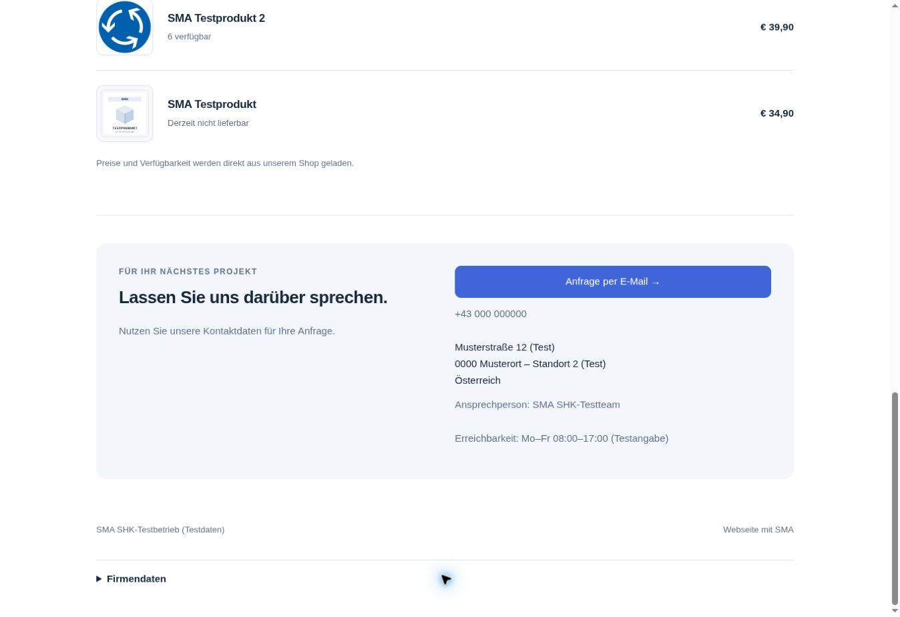
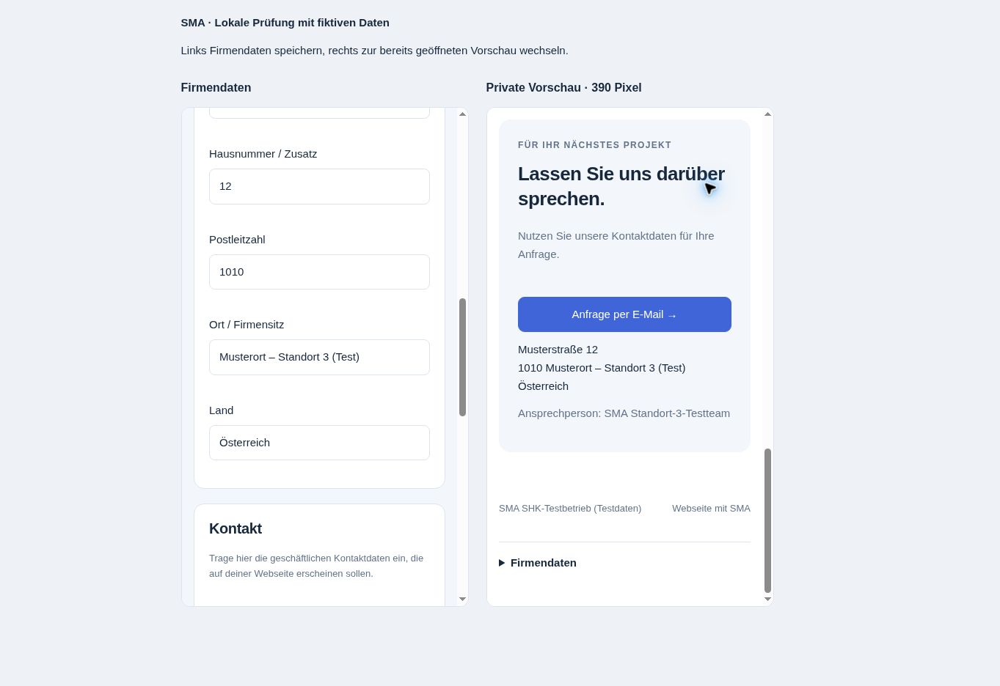

# Angemeldeter Kundentest: Firmendaten und private SMA-Webseite

Stand: 4. November 2026. Der Ablauf wurde in der ausgelieferten SMA-Oberfläche mit einer regulären SMA-Anmeldung im bestehenden Delta-Demo-Testkonto geprüft. Die Schreibvorgänge erfolgten über die Kundenoberfläche, nicht über direkte Datenbankänderungen oder simulierte Browserantworten.

## Durchgeführter Ablauf

1. „Webseite & Domain“ → „Webseite einrichten“ → „Firmendaten bearbeiten“ geöffnet. Das Profil war noch nicht gespeichert; kein vorhandenes Firmenprofil wurde überschrieben.
2. Alle 16 Felder mit eindeutig fiktiven Angaben gespeichert. Firmenname: **SMA SHK-Testbetrieb (Testdaten)**; E-Mail `kontakt@example.com`; Anschrift, Telefonnummer und Registerangaben ausdrücklich als Muster/Test gekennzeichnet. Die Oberfläche bestätigte die Speicherung.
3. Über „Zur Webseite“ genau einen privaten Webseitenentwurf erzeugt. Firmenname, Geschäftsadresse und öffentliche Kontaktdaten wurden ohne zweite Eingabe übernommen; der vorhandene SMA-Testshop wurde automatisch zugeordnet.
4. Überschrift, Vorstellung, Über-uns-Text und drei Leistungsbereiche für Sanitär, Heizung und Klima bearbeitet und gespeichert. Die private Vorschau zeigte diese Texte und die drei vorhandenen Produkte mit Bildern beziehungsweise Bildplatzhalter, Preisen und Verfügbarkeit.
5. Das Firmenprofil erneut geöffnet: gespeicherte Angaben waren vorhanden. Den Ort von „Musterort“ auf „Musterort – Standort 2 (Test)“ und die Ansprechperson auf „SMA SHK-Testteam“ geändert und gespeichert.
6. Webseiteneditor erneut geöffnet und private Vorschau neu geladen. Beide übernahmen die geänderte Adresse ohne erneute Eingabe oder separates Speichern der Webseite. Die Vorschau übernahm außerdem die neue Ansprechperson; die vorher gespeicherten SHK-Texte blieben erhalten. Auch die Firmendatenkarte im wieder geöffneten Dashboard zeigte den neuen Stand.
7. Die Darstellung des gerenderten Testentwurfs zusätzlich als lokale Layoutaufnahme im 390-Pixel-Handyrahmen geprüft: 375 Pixel nutzbare Breite und 375 Pixel Inhaltsbreite, kein horizontaler Überlauf. Startbereich und Kontaktbereich waren lesbar. Dies ist eine Layoutprüfung der tatsächlich gerenderten Inhalte, kein separater mobiler Authentifizierungstest.
8. Eine lesende native Datenbankprüfung bestätigte Profilrevision 2, Webseitenrevision 2 und genau eine Webseite für das Testprofil. `published`, `published_company` und `published_at` waren weiterhin leer. Ein anonymer HTTP-Aufruf der öffentlichen Webseiten-RPC für diesen Entwurf lieferte `NOT_AVAILABLE`.

Die Testangaben und der private Entwurf bleiben im Demo-Testkonto zur weiteren Prüfung erhalten. Es wurde keine Webseite veröffentlicht, kein Kontaktformular oder E-Mail-Versand ausgelöst und kein externer WordPress-Auftrag gestartet. Anmelde- und Zahlungsdaten wurden nicht geändert. Der Screenshot zeigt ausschließlich fiktive Firmenangaben und bereits öffentliche Testprodukte.

## Kleine Korrektur aus dem Kundentest

Im Einrichtungsbereich stand noch, die automatische WordPress-Einbindung werde ergänzt. Der Hinweis beschreibt jetzt den bereits vorhandenen Ablauf: Nach bestätigter Verbindung kann der Kunde seinen SMA-Produktbereich automatisch als Entwurf erzeugen. Layout, Schrift und Funktionsumfang bleiben unverändert; der Dashboard-Import erhält eine neue Cache-Version. Die acht vorhandenen Webseiten-Vorbereitungstests und die WordPress-Dashboard-DOM-Prüfung bestanden nach dieser Textkorrektur; `git diff --check` ist sauber. Der zuvor bestandene Gesamtstand bleibt bei 359 Node-Tests.

## Grenzen und nächster Schritt

- Der Test bestätigt den privaten Erstellungs- und Bearbeitungsweg im angemeldeten Demo-Konto mit fiktiven Daten. Eine Veröffentlichung mit echten Firmendaten wurde nicht abgenommen.
- Ein bereits offener Editor wurde für die nachgewiesene Übernahme erneut geöffnet; eine automatische Tab-Fokus-Aktualisierung wird aus diesem Browserlauf nicht zusätzlich abgeleitet.
- Der WordPress-Produktentwurf ist implementiert, aber der positive Ende-zu-Ende-Test auf einer ausdrücklich freigegebenen externen WordPress-/MySQL-Testseite bleibt offen. Noch keine solche Seite verbunden; kein neues Hosting buchen.
- Eigene Kundendomains benötigen weiterhin ihren jeweiligen Nachweis und eine gesonderte konkrete Anbindung. Keine DNS- oder Tarifänderung vorgenommen.
- PR #57 bleibt separat. Social-Media-Uploads/Postings benötigen ausdrückliche Freigabe; Sightengine bleibt `VIDEO_PLAN_REQUIRED`, Meta und Serverumbau bleiben zurückgestellt.

Fortsetzung: Die abgeschlossene Profil-/Entwurfsprüfung nicht erneut starten. PR #69 enthält den bestandenen lokalen WordPress-/MariaDB-Praxistest und bleibt separat offen. Eine externe Testadresse fehlt weiterhin. Die [individuelle Gestaltung der SMA-Webseite](CUSTOMER_WEBSITE_DESIGN.md) ist inzwischen über PR #71 live und geprüft. Der folgende Kundenschritt [eigene Logos und Startseitenbilder](CUSTOMER_WEBSITE_IMAGES.md) ist inzwischen über PR #72 ebenfalls live und im echten privaten Upload-/Speicherablauf geprüft. Nach dem Test wurde die ursprüngliche Darstellung wiederhergestellt; Revision 6, weiterhin privat.

Der folgende Schritt [Domainnachweis für neue SMA-Webseiten](CUSTOMER_WEBSITE_DOMAIN_PROOF.md) ist über **PR #73 live**. Serverprüfungen mit zurückgerollten synthetischen Daten und die angemeldete Lese-/Navigationsprüfung im Dashboard sind bestanden. Keine Domain gespeichert, keine DNS-Abfrage und keine Änderung des privaten SHK-Entwurfs. Ein echter positiver DNS-Nachweis und die Domain-Verknüpfung brauchen weiterhin eine freigegebene Domain mit konkreter Anbieterzuordnung.

## Ergänzung: offene private Vorschau

Am 4. November 2026 wurde die private Vorschau um eine automatische Aktualisierung beim Zurückwechseln ergänzt. Der oben dokumentierte angemeldete Browserlauf bleibt ein eigener, früherer Nachweis. PR #70 ist inzwischen zusammengeführt und live geprüft. Die folgenden Punkte dokumentieren die zuvor durchgeführten lokalen Prüfungen; sie sind kein Hinweis auf eine noch ausstehende Freigabe.

- `customer-website-view.mjs` lädt ausschließlich den gespeicherten Entwurf und das aktuelle Firmenprofil neu. Auslöser sind Fokus, erneute Sichtbarkeit und Wiederherstellung aus dem Browser-Seitencache. Unveränderte Inhalte bleiben bestehen; keine zusätzlichen Bedienelemente, Schrift- oder Layoutänderungen.
- Kontowechsel leeren die Vorschau sofort. Besitzerprüfung vor und nach jeder Antwort sowie die Entwertung laufender Aufrufe verhindern die erneute Anzeige alter Kontodaten. Öffentliche Seiten laden ausschließlich ihren veröffentlichten Stand.
- Zwölf neue DOM-Szenarien bestanden, einschließlich Wiederholung nach Ladefehler, zusammengefasster Rückkehrereignisse, serieller Leseanfragen und Aufräumen beim Verlassen. Zusätzlich bestanden die vorhandenen Profil-/Webseiten-DOM-Prüfungen und alle 359 Node-Tests.
- Lokaler Browserlauf mit den echten Editor-/Renderer-/Vorschau-Modulen, aber fiktivem Konto und simuliertem Lesen/Speichern über lokalen Browserspeicher: Ort auf „Musterort – Standort 3 (Test)“ und Ansprechperson auf „SMA Standort-3-Testteam“ geändert und über „Firmendaten speichern“ gespeichert. Beim Fokuswechsel zur bereits geladenen Vorschau erschienen beide Werte ohne Neuladen; gespeicherte SHK-Texte blieben erhalten.
- Die Fokusprüfung erfolgte zwischen zwei eingebetteten 390-Pixel-Browseransichten. Die Vorschau hatte 375 Pixel nutzbare Breite und 375 Pixel Inhaltsbreite, also keinen horizontalen Überlauf. Ein erfolgreicher Wechsel zwischen zwei eigenständigen Browsertabs oder eine erneute reale Supabase-Speicherung wird daraus nicht abgeleitet; Sichtbarkeits- und Browsernavigation-Ereignisse sind durch die DOM-Szenarien abgedeckt.

Es wurden keine Produktionsdaten verändert, keine Webseite veröffentlicht, kein Hosting gebucht und keine WordPress-Verbindung angelegt. Der bestehende private SHK-Entwurf im Demo-Konto bleibt erhalten. PR #57 bleibt separat; der lokale WordPress-Praxistest liegt gesondert in PR #69. Ein externer WordPress-Test wartet auf eine vorhandene geeignete Testseite. Die Vorschauänderung ist über PR #70 bereits in `website-v1` und live. Der danach ergänzte Gestaltungsbereich ist inzwischen über PR #71 ebenfalls live und im privaten Speicherablauf geprüft: [aktueller Stand](CUSTOMER_WEBSITE_DESIGN.md).
