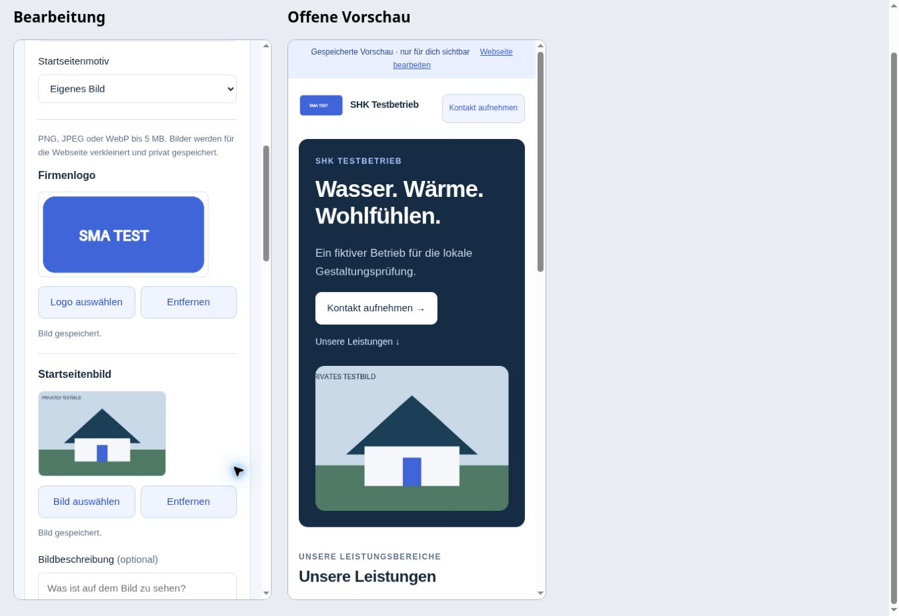
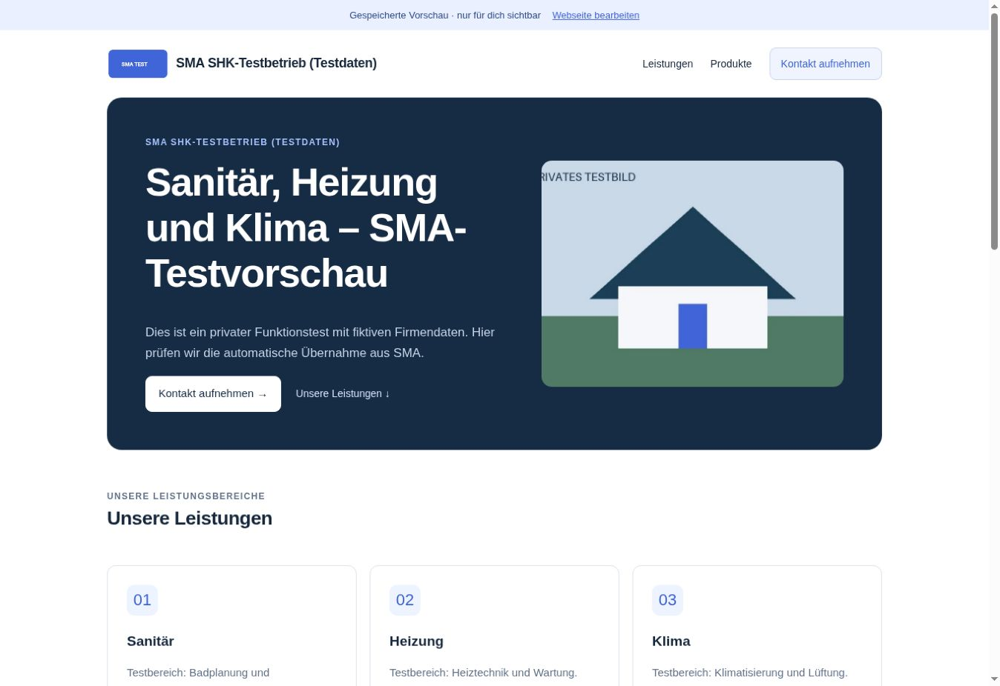

# Eigene Bilder für SMA-Kundenwebseiten

Stand: 4. November 2026. Aufbauend auf der bereits live geprüften Gestaltung aus PR #71 (`website-v1`, Ausgangscommit `f09a230`). **PR #72 ist nach Freigabe zusammengeführt, live bereitgestellt und im angemeldeten privaten Kundenablauf geprüft.** Der SHK-Testentwurf wurde nach dem Bildtest auf seine ursprüngliche Darstellung zurückgestellt. Einzelheiten und Endzustand unter „Bereitstellung und Live-Abnahme“.

## Kundenablauf

Unter **Webseite bearbeiten → Gestaltung** gibt es zwei kompakte Bildfelder: **Firmenlogo** und **Startseitenbild**. Der Bereich bleibt beim Öffnen zugeklappt; Schrift und übrige Oberfläche bleiben erhalten.

1. „Logo auswählen“ beziehungsweise „Bild auswählen“ öffnet die Dateiauswahl. Zulässig sind PNG, JPEG und WebP bis 5 MB und 32 Millionen Bildpunkte. Der Browser dekodiert und verkleinert das Bild und erzeugt eine neue Bilddatei. Originaldatei und EXIF-Daten werden nicht hochgeladen; ein neu erzeugtes JPEG-Farbprofil kann erhalten bleiben.
2. Das Logo wird als PNG mit höchstens 512 Pixeln an der längsten Seite gespeichert, mit Transparenz. Das Startseitenbild wird als JPEG mit höchstens 1600 Pixeln und weißem Hintergrund gespeichert. Jede gespeicherte Datei ist auf 2 MB begrenzt. Startseitenbilder erscheinen mittig in einem 4:3-Ausschnitt; eine optionale Bildbeschreibung dient als Alternativtext.
3. Die Auswahl wird zunächst privat hochgeladen. Erst **Änderungen speichern** übernimmt ihre ID gemeinsam mit den Texten in den Entwurf. Die bisherige Auswahl bleibt bei einem fehlgeschlagenen Upload erhalten. Während der Verarbeitung sind Speichern und Veröffentlichen gesperrt. Ein Dateiauswahldialog oder Upload löst keine Webseitenveröffentlichung aus.
4. **Entfernen** entfernt die Auswahl aus dem Formular. Nach dem Speichern fehlt sie im Entwurf; beim Startseitenbild wird wieder das Hausmotiv verwendet. Ein bereits veröffentlichter Stand behält seine bisherigen Bilder bis zur ausdrücklichen Aktualisierung oder Offline-Schaltung.

Die Bild-ID-Felder `logo_image_id` und `hero_image_id` sowie `hero_image_alt` sind optional. Alte Inhalte bleiben gültig. Alte Schreibanfragen ohne diese Felder erhalten gespeicherte Bildbezüge; fremde oder nicht abgeschlossene Uploads können nicht gespeichert oder veröffentlicht werden. Schon geöffnete alte Browserfassungen müssen nach Bereitstellung neu geladen werden, weil ihre Inhaltsprüfung neue Felder noch nicht kennt.

## Privater Speicher und öffentlicher Stand

- Neuer privater Bucket **`sma-webseitenbilder`**, ausschließlich PNG/JPEG, höchstens 2 MB je Objekt. Der vorhandene Produktbild-Bucket wird nicht verändert. Eine restriktive Storage-Regel sperrt direkte Zugriffe durch `anon` und `authenticated`, auch wenn später eine breite erlaubende Regel hinzukommt.
- `sma_private.website_images_v1` speichert Besitzer, Kunde, UUID, MIME-Typ, Größe, Abmessungen, SHA-256 und Lebenszyklus. RLS ist aktiv; direkte Tabellenrechte sind entzogen. Nur der servicegeschützte RPC `sma_website_image_service_v1` ist für die Edge-Funktion aufrufbar.
- Der neue Endpunkt **`sma-website-image`** authentifiziert private GET/POST-Anfragen serverseitig. Uploads benötigen eine bestehende eigene Webseite und aktiven Delta-Zugang. Private Bilder bleiben für den bestehenden Besitzer auch nach Zugangsablauf lesbar.
- Öffentliche Bildabrufe müssen zusätzlich die konkrete Seiten-ID nennen. Der Server erlaubt nur Bilder im ausdrücklich veröffentlichten Snapshot, bei weiterhin passender Besitzerzuordnung und aktivem Zugang. Ein ungenutztes Startseitenbild ist nicht öffentlich, wenn ein anderes Motiv gewählt ist. Nach dem Download wird die Berechtigung nochmals geprüft. Kein Fallback auf den privaten Entwurf.
- Objektpfade werden ausschließlich aus geprüfter UUID und festgelegter Dateiendung gebildet. Keine frei eingegebenen URLs, keine signierten URLs im Browser und kein öffentlicher Bucket. Auslieferung mit `no-store`, festem Bildtyp und `nosniff`; im Browser werden kurzlebige Blob-URLs verwendet und beim Wechsel wieder freigegeben. Bereits angezeigte oder heruntergeladene öffentliche Kopien können naturgemäß nicht zurückgerufen werden.
- Die Serverprüfung begrenzt Bytezahl, Dauer und Abmessungen, prüft PNG-Chunks/CRC und JPEG-Segmente sowie den SHA-256-Abgleich. Sie ist **eine Strukturprüfung, kein vollständiger serverseitiger Pixeldecoder und keine Inhaltsmoderation**. EXIF, Kommentare, SVG, fremde Metadatenmarker und überlange Farbprofile werden abgewiesen. Die vollständige Bilddekodierung und Neucodierung erfolgen im Browser.
- Wiederholte Anfragen mit derselben UUID und denselben Metadaten sind idempotent. Storage-Dateien werden nicht überschrieben. Ein vorhandenes Objekt wird bei einem wiederholten Upload durch seinen Digest abgeglichen. Kontowechsel vor/nach Verarbeitung und Upload sowie verspätete Miniaturansichten dürfen keine fremden oder entfernten Bilder wieder ins Formular einsetzen.

## Begrenzung und Aufräumen

Pro Kunde sind höchstens zwölf neue Uploadreservierungen pro Stunde und 24 nicht gelöschte Bildkopien erlaubt; unterbrochene Uploads zählen mit. Der normale Kunde benötigt je ein Logo und Startseitenbild sowie gegebenenfalls die bisherigen öffentlichen Kopien.

Bei einem späteren Upload werden bis zu zwölf mindestens 24 Stunden alte Kopien bereinigt, die weder im aktuellen Entwurf noch im veröffentlichten Snapshot referenziert sind. Die Datenbank markiert sie unter derselben Kundensperre wie das Speichern zunächst als `deleting`; ab dann können sie nicht erneut angehängt werden. Erst nach erfolgreichem Storage-Löschen werden sie als `deleted` markiert. Fehlgeschlagenes Aufräumen wird bei einem späteren Upload erneut versucht. Ohne weitere Uploads läuft kein geplanter Löschauftrag. Es wird kein zusätzlicher kostenpflichtiger Dienst gebucht; tatsächliche Speichernutzung bleibt im bestehenden Supabase-Projekt.

## Prüfung und Grenzen

- **381 Node-Tests bestanden**: 362 bestehende plus 19 Bildtests für echte PNG/JPEG-Dateien, Farbprofile, defekte/zu große Daten, Lesezeitlimit, Konvertierung, Authentifizierung, Accountbindung, Wiederholung, konkurrierende Objektinhalte, öffentliche Leseberechtigung und erneute Prüfung nach dem Download.
- **Zehn neue DOM-Szenarien bestanden**: Auswahl/Speichern/Wiederaufruf, Textschutz, Entfernen, laufender Upload, Kontowechsel, fehlgeschlagener Ersatz, verspätete Miniaturansichten, Blob-Lebenszyklus, sichere Alternativtexte und getrennte öffentliche/private Abrufe.
- Alle bisherigen Webseiten-, Gestaltung-, Firmenprofil- und WordPress-DOM-Prüfungen bestanden, darunter die zwölf bereits vorhandenen Vorschauaktualisierungs-Szenarien.
- Lokales PostgreSQL/PGlite: Service-/Direktrechte, Besitzer und aktive Pakete, unveränderliche Reservierung, fremde Bildabrufe, private/öffentliche Snapshots, alte Inhalte und Schreibanfragen, sichere Bereinigung, Uploadlimits, Offline-Schaltung/Besitzerwechsel und restriktive Storage-Policy. Alle Fixtures zurückgerollt. Die lokale Storage-Tabelle prüft die SQL-Rechte; sie ersetzt keinen echten Storage-API-Durchlauf.
- Deno-Typprüfung für den neuen Edge-Einstieg und `git diff --check` bestanden.
- Browserprüfung mit echten Produktionsmodulen, synthetischem transparentem PNG-Logo und WebP-Startseitenbild: Auswahl, tatsächliche Canvas-Neucodierung, anschließende Server-Strukturprüfung, lokales Speichern und erneutes Laden samt sichtbaren Bildern. Browser-JPEGs enthalten ein ICC-Farbprofil; die zunächst zu strenge Ablehnung wurde behoben und durch einen Regressionstest ergänzt. Die private Kontositzung und Speicherung waren in diesem Lauf simuliert; die Bildkopien lagen ausschließlich im lokalen Prüfspeicher.
- Zwei 390-Pixel-Handyrahmen: 375 Pixel nutzbare Breite und 375 Pixel Inhaltsbreite. Desktop: 1348 Pixel für beides. Kein horizontaler Überlauf; Logo und Startseitenbild vollständig dekodiert. Die letzte WebP-Wiederholung verwendete einen lokalen Prüfbutton mit derselben Datei und demselben Dateifeld, nachdem der Dateidialog der Browsersteuerung minutenlang benötigte.



```sh
node --test tests/*.test.cjs
node tests/run-customer-websites-sql.mjs
node tests/run-customer-website-images-dom.mjs
for testfile in tests/run-*-dom.mjs; do node "$testfile"; done
deno check supabase/functions/sma-website-image/index.ts
git diff --check
```

Die oben aufgeführten lokalen Prüfungen veränderten keine Produktionsdaten. Der anschließend freigegebene echte Supabase-Storage-/Edge-Durchlauf ist inzwischen ebenfalls bestanden; siehe unten. Es wurde keine Kundenwebseite veröffentlicht.

## Ausgeführte Bereitstellungsreihenfolge

1. Bestehenden privaten Entwurf und veröffentlichten Zustand lesend sichern/abgleichen. In einer Migration zuerst `supabase/sql/customer-website-images.sql`, danach die aktualisierte `supabase/sql/customer-websites.sql` installieren. Im bestehenden Projekt ist die Webseitentabelle bereits vorhanden. Die Installation verändert keinen gespeicherten Webseiteninhalt.
2. `supabase/functions/sma-website-image/index.ts` samt lokalen Imports bereitstellen. **`verify_jwt=false`** ist für den öffentlichen Bildpfad und Publishable-Key erforderlich; private Aufrufe werden innerhalb der Funktion über `/auth/v1/user` geprüft. Sie benötigt nur die vorhandenen serverseitigen `SUPABASE_URL`/`SUPABASE_SERVICE_ROLE_KEY`. Keine neuen Kunden-Credentials oder Browserzugänge.
3. Erst danach den PR nach `website-v1` übernehmen und die geänderten versionierten Oberflächenmodule ausliefern. Die neue Oberfläche darf nicht vor SQL und Edge freigeschaltet werden.
4. Angemeldeten privaten Test durchführen: synthetisches Logo/Bild hochladen, Entwurf speichern, Vorschau neu laden, anonymen Bildzugriff weiterhin abweisen, anschließend alte Gestaltung/Bildauswahl wiederherstellen. Entwurf und Firmenprofil bleiben privat. Öffentliche Freigabe nur mit gesondertem Auftrag; lokale Snapshot-Tests sind keine Freigabe für eine reale Veröffentlichung.

Ein Zurückrollen muss die bereits gespeicherten optionalen Bildfelder weiter akzeptieren. Bucket und Bildtabelle nicht als Rollback löschen; zuerst den Uploadweg sperren oder vorwärts korrigieren und vorhandene Referenzen lesbar halten.

PR #70 und #71 sind abgeschlossen und live. PR #69 bleibt separat offen: lokaler WordPress-/MariaDB-Test bestanden, keine externe Testseite vorhanden und weiterhin nur Produktbereich, keine Firmenprofiltexte. PR #57 bleibt separat. Eigene Kundendomains benötigen weiterhin eine konkrete freigegebene Anbindung. Sightengine: `VIDEO_PLAN_REQUIRED`; Meta und Serverumbau später.


## Bereitstellung und Live-Abnahme

Die Freigabe des Nutzers erfolgte am 4. November 2026 nach der Vorlage von PR #72 und der lokalen Bildvorschau.

- Migration **`20261104174541_customer_website_images_v1`** installiert. Die bestehenden Funktionsdefinitionen stimmten vorher mit dem freigegebenen Ausgangsstand überein; die installierten Definitionen stimmen mit PR #72 überein. Alle acht überprüften Funktionen behalten den leeren Suchpfad; öffentliche Wrapper sind weiterhin Invoker.
- Vor und nach der Installation blieb die Prüfsumme der bestehenden Webseitenzeile identisch (`4c20fdb3c95f5e4b0d0bb1f1ecaf9fde`). Genau eine Webseite, null veröffentlichte Seiten, Revision 4 und Blau/Hausmotiv. Der neue Bildspeicher war leer, privat und auf 2 MB PNG/JPEG begrenzt. Browserrollen haben weder direkte Tabellenrechte noch Ausführungsrechte auf dem Bild-Service-RPC; Service-RPC und RLS sind aktiv.
- Edge-Funktion **`sma-website-image`**, Version 1, ist aktiv. Fehlende Anmeldung liefert HTTP 401 `AUTH_REQUIRED`; ein nicht veröffentlichter Bildabruf liefert HTTP 404 `IMAGE_UNAVAILABLE`, jeweils mit `no-store` und korrekter CORS-Freigabe für die SMA-Oberfläche.
- Der Advisor meldet für die neue private Tabelle ausschließlich den erwarteten [RLS-ohne-Direktzugriff-INFO-Hinweis](https://supabase.com/docs/guides/database/database-linter?lint=0008_rls_enabled_no_policy). Die weiteren Hinweise betreffen unveränderte vorhandene Funktionen und die Auth-Konfiguration; sie wurden durch diese Erweiterung nicht geändert.
- PR #72 wurde mit Commit `261890e25c27dfbb02271df8b5c4f734327f3db8` nach `website-v1` zusammengeführt. Auslieferung: [GitHub Pages 41880445762](https://github.com/sma-automation/sma-automation.github.io/actions/runs/41880445762).

- Die Pages-Auslieferung war erfolgreich. Der ausgelieferte Editor und die Editor-, Bild-, Renderer- und API-Module stimmen bytegenau mit der freigegebenen Fassung überein. Das vollständig ausgelesene Edge-Paket stimmt ebenfalls mit allen sieben lokalen Dateien überein.
- In der vorhandenen angemeldeten Kundensitzung ein synthetisches PNG-Logo und ein WebP-Startseitenbild über die regulären Dateifelder ausgewählt. Beide Uploads erfolgreich: PNG **320 × 160, 4.426 Bytes** und umgewandeltes JPEG **960 × 640, 17.020 Bytes**, jeweils `ready` und mit übereinstimmender Dateigröße im echten privaten Storage.
- Über **Änderungen speichern** beide Bildbezüge und eine fiktive Bildbeschreibung übernommen: Webseitenrevision **5**, Motiv `image`, weiterhin unveröffentlicht. Private Live-Vorschau erneut geladen: beide Bilder wurden über den authentifizierten Edge-Endpunkt vollständig dekodiert und als Blob-URLs angezeigt. Danach auch den Editor neu geladen: beide Miniaturen, das Motiv und die Bildbeschreibung waren gespeichert. Kein simulierter Speicherweg in diesem Test.
- Ohne Anmeldung: privater Logo-Abruf HTTP 401 `AUTH_REQUIRED`; Logo und Startseitenbild über den öffentlichen Seitenpfad jeweils HTTP 404 `IMAGE_UNAVAILABLE`; direkter öffentlicher Storage-Abruf ebenfalls abgewiesen (`Bucket not found`). Die öffentliche Webseiten-RPC antwortete weiterhin `NOT_AVAILABLE`.
- Anschließend beide Bildauswahlen über **Entfernen** und **Änderungen speichern** wieder aus dem Entwurf genommen. Endzustand **Revision 6**, Blau, Hausmotiv, leere Bildbezüge und leere Bildbeschreibung. Genau eine private Webseite; `published`, `published_company` und `published_at` weiterhin leer. Die Prüfsummen der übrigen Webseiteninhalte und des vollständigen Firmenprofils sind vor/nach dem Test identisch.
- Die zwei kleinen synthetischen Bildkopien bleiben ausschließlich privat und ohne Entwurfsbezug gespeichert. Sie fallen nach 24 Stunden beim nächsten Upload unter die dokumentierte Bereinigung; kein manueller Löschauftrag oder Termin wurde eingerichtet.



Der Bildschritt ist abgeschlossen. Der vorhandene SHK-Testentwurf bleibt privat gespeichert. Die bereits abgenommenen Schritte aus PR #70/#71 nicht erneut starten. PR #69 und #57 bleiben separat offen; keine kostenpflichtige Änderung, keine externe WordPress-Testseite und keine öffentliche Kundenveröffentlichung. Eigene Kundendomains bleiben ein gesonderter Schritt mit konkreter Domain-/Anbieterzuordnung.
