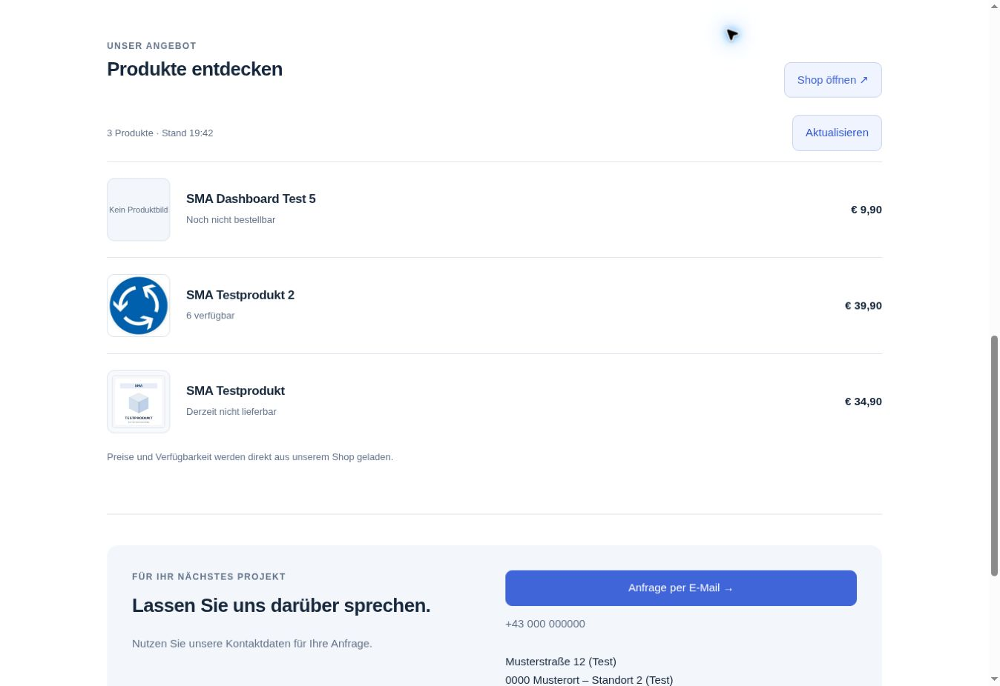
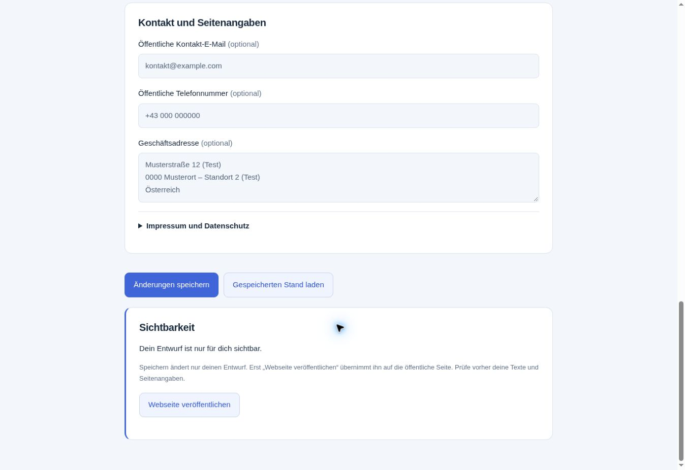

# Öffentlicher Kundentest der SMA-Webseite

Stand: **4. November 2026, abgeschlossen.** Der Nutzer gab den konkret beschriebenen Ablauf frei: gekennzeichnete SHK-Testseite kurz unter ihrer vorhandenen SMA-Adresse veröffentlichen, öffentlich prüfen und wieder offline nehmen. Keine neue Domain oder Buchung.

## Ergebnis

Die Veröffentlichung und Offline-Schaltung wurden über die regulären Buttons im angemeldeten Webseiteneditor durchgeführt. Für diese Prüfung waren weder Codeänderungen noch neue Migrationen erforderlich.

| Zustand | Webseitenrevision | Öffentlicher Abruf ohne Anmeldung |
| --- | ---: | --- |
| Vor dem Test | 6 | `NOT_AVAILABLE` |
| Veröffentlicht, 19:42:03 MEZ | 7 | Webseite und freigegebener Firmenstand abrufbar |
| Wieder offline, 19:44:04 MEZ | 8 | `NOT_AVAILABLE` |

Die Testseite war rund zwei Minuten öffentlich. Am Ende existiert weiterhin genau **eine private Webseite**. `published`, `published_company` und `published_at` sind leer; Firmenprofilrevision **2** unverändert.

## Durchgeführte Prüfungen

- Vor der Veröffentlichung die gespeicherten Inhalte geprüft: ausschließlich als Test/Muster gekennzeichnete SHK-Firmendaten, `kontakt@example.com`, fiktive Anschrift und Telefonnummer. Blau, Hausmotiv, keine ausgewählten eigenen Logo-/Startseitenbilder.
- **Webseite veröffentlichen**: Editor bestätigte „Online“ und den gespeicherten Stand. Veröffentlichter Firmensnapshot entspricht Profilrevision 2; der private Entwurf wurde dabei inhaltlich nicht verändert.
- Die öffentliche Webseiten-RPC wurde mit dem öffentlichen API-Schlüssel, **ohne Authorization-Header, Cookies oder Benutzeranmeldung** aufgerufen. Erfolgreiche Antwort mit Seite, veröffentlichten Inhalten, Firmenprofil und zugeordnetem Shop-Link; keine internen Benutzer-/Kundenkennungen.
- Den öffentlichen Seitenlink zusätzlich im Browser geöffnet: SHK-Überschrift, Hausmotiv, drei Leistungsbereiche, Testkennzeichnung und gespeicherte Kontaktdaten sichtbar. Die Browserdarstellung nutzte den öffentlichen Seitenpfad; der unabhängige anonyme HTTP-Test belegt den Zugriff ohne Anmeldung. Die bestehende SMA-Anmeldung wurde nicht abgemeldet.
- Produktbereich: **drei Produkte**, darunter ein korrekter Bildplatzhalter. Beide vorhandenen Produktbilder wurden ohne Anmeldung mit HTTP 200 geladen (WebP, 27.860 und 18.004 Bytes) und im Browser vollständig dekodiert (800 × 800 bzw. 1.200 × 1.200). Preise und die drei unterschiedlichen Verfügbarkeitszustände erschienen korrekt. Der Shop-Link zeigte auf den vorhandenen SMA-Testshop.
- Beide früher hochgeladenen, inzwischen nicht mehr ausgewählten privaten Webseitenbilder blieben selbst während der Veröffentlichung über den öffentlichen Bildpfad mit **404 `IMAGE_UNAVAILABLE`** gesperrt. Ein positiver öffentlicher Abruf eigener Logo-/Startseitenbilder war mangels ausgewählter Bilder nicht Bestandteil dieses Tests.
- **Webseite offline nehmen**: Editor bestätigte „Entwurf“ und „Dein Entwurf ist nur für dich sichtbar“. Der erneute anonyme HTTP-Aufruf lieferte `NOT_AVAILABLE`. Nach Neuladen zeigte auch der öffentliche Browserlink „Diese Webseite ist derzeit nicht verfügbar“.
- Entwurfsprüfsumme vor/nach dem Test identisch: `9fea0bbcbc9a81f0faf26de0ccbefcfe`. Firmenprofilprüfsumme ebenfalls unverändert: `fd0bb9a29f41592461b15d47eb14ce1f`. Texte, Gestaltung, Kontakte und Bildauswahl bleiben erhalten.

## Fortsetzung und Grenzen

Der öffentliche Veröffentlichungs-/Offline-Ablauf mit fiktiven Testdaten ist abgeschlossen und muss nicht erneut begonnen werden. Die vorhandenen 383 automatisierten Tests und DOM-/SQL-Nachweise bleiben der zuletzt bestandene Code-Prüfstand; in diesem Schritt wurde kein Programmcode geändert.

Keine Bestellung, Zahlung, Kontaktübermittlung oder E-Mail ausgelöst. Keine echten Firmenangaben öffentlich abgenommen und keine dauerhafte öffentliche Freigabe erteilt. Die vorhandene Testseite ist wieder offline.

Als nächster Domainschritt fehlen eine konkret freigegebene Kundendomain mit Anbieterzuordnung und die technische Verbindung zur richtigen SMA-Seite einschließlich HTTPS. Der Domainnachweis aus PR #73 ist bereits live. Der externe WordPress-Praxistest bleibt mangels freigegebener externer Testseite offen; PR #69 enthält den bestandenen lokalen Test und überträgt weiterhin nur den Produktbereich. PR #57 bleibt separat, Sightengine `VIDEO_PLAN_REQUIRED`, Meta und Serverumbau später.
