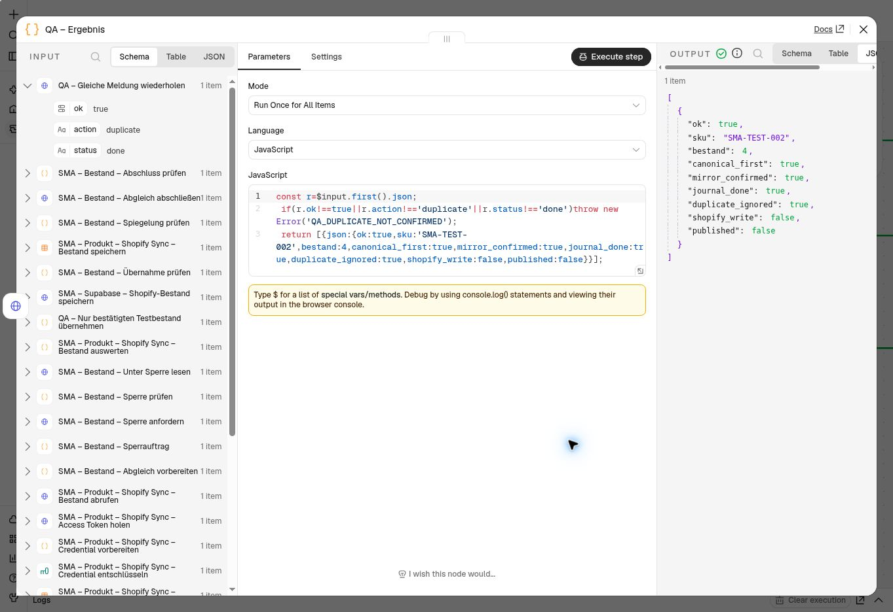
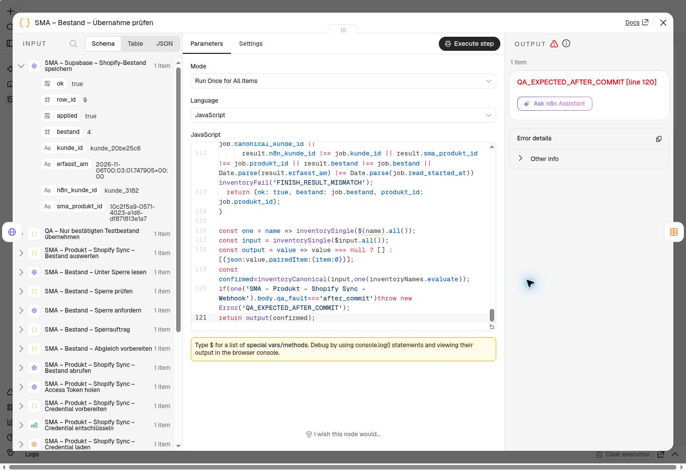
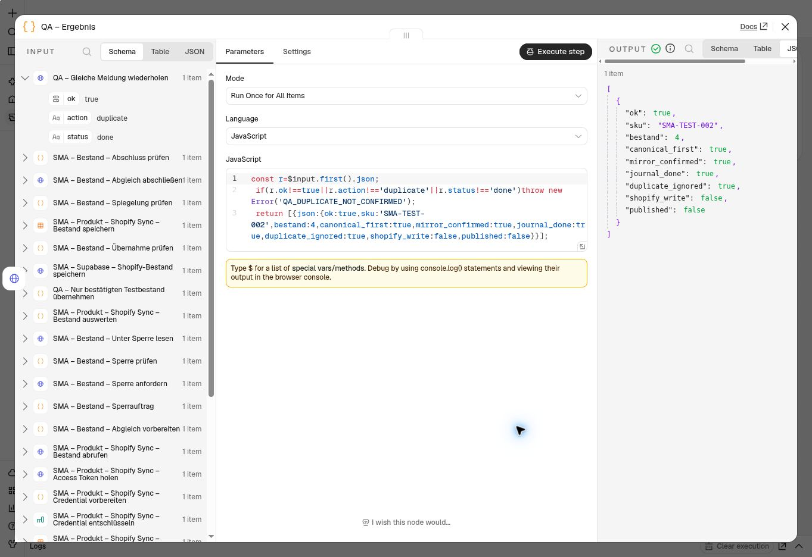
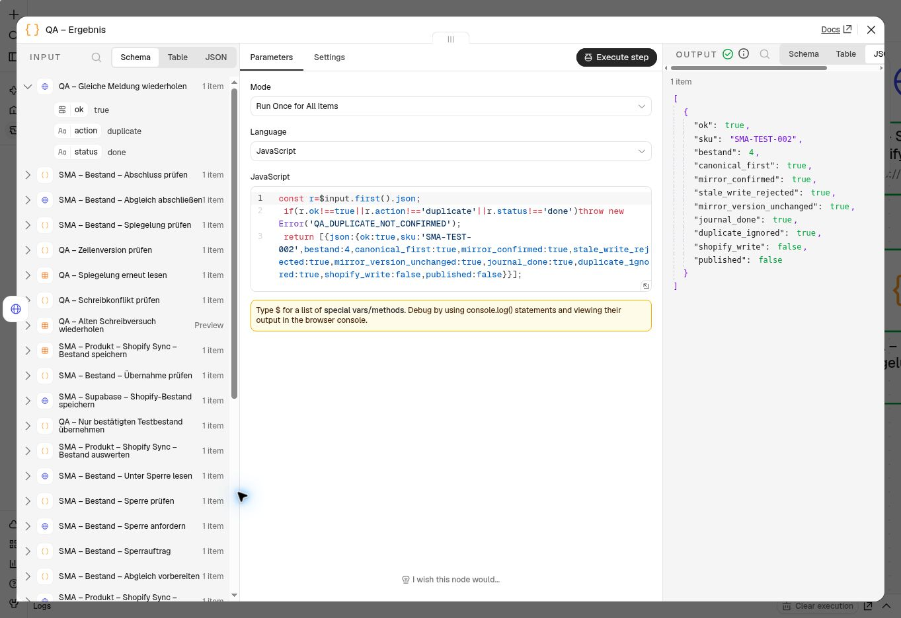

# Shopify-Bestandsentwurf: Übernahme vor Spiegelung

Aktuelle Fortsetzung: [Produktiver Rollout abgeschlossen](SHOP_INVENTORY_ROLLOUT.md).
Die folgenden Angaben dokumentieren den früheren isolierten Prüfstand. Der alte
524-Node-Gesamtkandidat wurde nicht veröffentlicht; produktiv ist die gezielt
aus der 511-Node-Basis erstellte und weiter abgesicherte 534-Node-Fassung.

Stand: 6. November 2026 (Europe/Vienna). **Echter n8n-Normallauf sowie Abbruch,
HTTP-Timeout, Wiederaufnahme und Ablehnung eines veralteten Tabellen-Writes bestanden; Kandidat weiterhin unveröffentlicht.** Der laufende Bestandsworkflow und der
erhaltene 515-Node-Entwurf wurden nicht verändert. Im Prüflauf wurden für
SMA-TEST-002 dieselben vier Stück in Supabase und n8n bestätigt. Einschließlich
der Wiederaufnahme- und Schreibkonflikttests wurden vier Journalmeldungen ergänzt;
alle 21 Meldungen sind abgeschlossen. Shopify Payments bleibt im Testmodus.

## Ausgangslage

PR #80 ist zusammengeführt und live; die Testkennzeichnung im Dashboard wurde
vom Betreiber bestätigt. Die Bestellstrecke ist für diesen Schritt abgeschlossen.

Der getrennt erhaltene 515-Node-Entwurf des Kundenworkflows enthält zusätzlich
einen Bestandszweig. Dieser schrieb zuerst in `SMA_Produkte` bei n8n und rief
danach `sma_shopify_bestand_uebernehmen_v1` auf. Lehnt Supabase eine veraltete
oder unpassende Auswertung ab, war die n8n-Zeile bereits geändert. Der Zweig
nutzte außerdem nicht die Sperre des bereits laufenden Bestands-Webhooks.

Lesende Bestandsaufnahme dieser Sitzung:

- Shopify bestätigt für SMA-TEST-002 vier Stück; Supabase enthält ebenfalls vier.
- SMA-TEST-001 hat bei Shopify einen Rohbestand von -6; SMA führt ihn als null
  verfügbare Stück. Das entspricht der bestehenden Behandlung negativer Werte.
- Vor dem Prüflauf enthielt das Bestandsjournal 17 abgeschlossene Meldungen, zuletzt zur
  Testbestellung #1010 am 5. November 2026 um 21:55:17 UTC.
- Die Definitionen der bestehenden Bestands-RPCs wurden gelesen. Es gibt in
  diesem Schritt keine Migration, Änderung an Rechten oder neue SQL-Funktion.

## Korrigierter Entwurf

`n8n/patch-inventory-draft.cjs` erstellt **nur eine lokale Kandidatendatei** aus
einem privaten Export. Es führt keine Netzwerkanfrage und keine n8n-Veröffentlichung
aus. Der private Gesamtexport mit Zugangskonfiguration gehört nicht ins Repository.

1. Die erste Shopify-Abfrage ermittelt und prüft Produkt, Variante und Inventar-ID.
   Ihr Mengenwert wird nicht gespeichert.
2. Kunde, Marktkonto und exakte HTTPS-Shopify-Domain werden gebunden. Aus der
   Workflow-/Ausführungskennung entsteht eine wiederholbare interne Lieferkennung.
3. Die vorhandene `sma_shopify_inventory_event_v1`-Sperre wird für das Konto und
   Inventarobjekt angefordert. Ein belegter oder ungültiger Zustand bricht ab;
   eine bereits abgeschlossene identische Ausführung endet ohne weitere Writes.
4. **Erst nach der Sperre** wird der Bestand erneut bei Shopify gelesen.
   Unvollständige Standortlisten, fremde Inventarobjekte, fehlende oder ungültige
   Mengen und abgelaufene Sperren werden zurückgewiesen.
5. Der vorhandene `commit`-Aufruf übernimmt den Bestand zuerst in Supabase und
   verwendet den serverseitigen Zeitpunkt des Sperrbeginns. Der Rückgabewert
   muss die aktuelle Übernahme, Kunden-/Produktzuordnung, Menge und Zeit bestätigen.
   `applied:false`, Fehler und unklare Antworten erreichen die n8n-Tabelle nicht.
6. Danach wird ausschließlich die nach Zeilen-ID, Kunde, Produkt und zuvor
   gelesener `updatedAt`-Version gefilterte n8n-Produktzeile geändert. Ein anderer
   Writer macht die alte Schreibbedingung ungültig. Eine leere Antwort bricht
   ausdrücklich mit `MIRROR_CONFLICT_RESTART_REQUIRED` ab. Erst eine passende
   Rückmeldung mit neuerer Zeilenversion erlaubt `finish` im Journal.
   Nur ein bestätigtes Journalergebnis wird als Abschluss ausgegeben.

Die Shopify-Abfrage bleibt unverändert und wird zweimal benutzt. Es gibt keine
Shopify-Mutation, Bestellung, Erstattung oder Änderung von Zahlungs-/Versanddaten.
Neue HTTP-Aufrufe haben 15 Sekunden Timeout; automatische Node-Wiederholungen
sind im sperrenden Abschnitt deaktiviert. Die SQL-Sperre läuft nach zwei Minuten
ab. Vor Commit/Spiegelung wird ein Zeitpuffer geprüft.

Der Patch prüft Fingerabdrücke der vier ursprünglichen Bestands-Nodes und ihrer
Verbindungen, Node-Typen und eingehenden Kanten. Bei Abweichungen oder gepinnten
Daten bricht er ab. Zugangsdaten, Produktmutationen, Bestellkennzeichnung, übrige
Nodes, Einstellungen und Workflow-Metadaten werden unverändert übernommen.
Aus dem gesicherten 515-Node-Entwurf entsteht ein Kandidat mit 524 Nodes.

## Prüfung und Freigabegrenze

```sh
node --test tests/inventory-integration.test.cjs tests/inventory-draft.test.cjs tests/shop-stock.test.cjs
git diff --check
```

53 Tests bestanden: 39 für Vertrag, Patch und isolierten Prüflauf, vier für die
gezielte Übernahme und zehn vorhandene
Dashboard-Bestandstests. Der synthetische Durchlauf führt die tatsächlich
eingebetteten Code-Nodes und HTTP-Body-Ausdrücke aus. Er prüft unter anderem
Kunden-/Kontobindung, Doppelaufrufe, belegte/abgelaufene Sperren, zweite Lesung,
GraphQL-Fehler, negative Mengen, Teilseiten, abgelehnte Datenbankantworten,
Spiegelungsfehler, Journalabschluss und unveränderte übrige Workflowteile.

Die wiederverwendete GraphQL-Abfrage ist gegen Admin API **2026-07** validiert.
Das bestätigt das Schema, nicht die Berechtigungen des konkreten n8n-Zugangs.
Ein exakter Vergleich des privaten Gesamtexports prüft zusätzlich, dass nur
die vorgesehenen Bestands-Nodes/-Verbindungen verändert und neun Nodes ergänzt
werden. Zugangskonfiguration und alle übrigen Inhalte bleiben gleich.

## Echter manueller Prüflauf

Nach erneuter Prüfung war die bestehende n8n-Anmeldung verfügbar; eine neue
Anmeldung war nicht nötig. Der frisch exportierte Originalentwurf stimmte in
allen Feldern exakt mit dem gesicherten 515-Node-Export überein.

`n8n/build-inventory-draft-qa.cjs` erstellt daraus einen **privaten** Prüflauf mit
26 Nodes. Er verwendet die bestehenden n8n-Zugänge, einen manuellen Trigger und
den korrigierten Bestandszweig. Vor dem Commit bindet ein zusätzlicher Wächter
Kunde, Konto, Shop, Variante, Produkt, SKU und den bestätigten Bestand von vier
Stück. Andere Produkte oder Mengen brechen ab. Der zweite Claim verwendet im
selben Lauf dieselbe Lieferkennung und muss `duplicate` / `done` liefern.

Getrennte n8n-Arbeitskopie: **QA – Shopify Bestandsentwurf – PR81**,
ID `iVy7hpNBjDLxV1Ro`, gespeichert und nicht veröffentlicht. Der Prüflauf hat
keinen Webhook-/Zeittrigger und enthält keine Shopify-Mutation.

Der echte Lauf am **5. November 2026, 23:41:28 UTC** (6. November, 00:41 Uhr Wien)
lief vollständig erfolgreich durch:

- Bestehender Shopify-Zugang und beide Bestandsabfragen funktionieren.
- Supabase bestätigt `applied:true`, vier Stück und den serverseitigen
  Erfassungszeitpunkt `2026-11-05T23:41:28.149654Z`.
- Die nachgelagerte n8n-Spiegelung wurde bestätigt; `finish` setzt die Meldung
  um `23:41:28.668319Z` auf `done`.
- Der identische zweite Claim liefert `duplicate` / `done`; er schreibt den
  Bestand kein zweites Mal.
- Unabhängige SQL-Nachprüfung: 18 abgeschlossene Meldungen insgesamt,
  genau ein Versuch für die neue Meldung, Bestand vier, keine laufende Sperre.
- Rückexport: alle 26 Nodes, ausführbarer Code, HTTP-Parameter und Verbindungen
  entsprechen dem Prüfkandidaten. n8n entfernt lediglich implizite Code-Defaults
  und die leere Ausgangsliste des End-Nodes.

Der Dateiimport übernimmt in dieser n8n-Oberfläche **keine allgemeinen
Workflow-Einstellungen**. Diese wurden deshalb im getrennten QA-Workflow
anschließend gesetzt: Timeout 90 Sekunden, künftige manuelle/erfolgreiche/
fehlgeschlagene Ausführungsdaten nicht dauerhaft speichern. Der erste erfolgreiche
Lauf verwendete noch die n8n-Standardeinstellungen. Keine Rohdaten oder
Zugangskonfiguration werden ins Repository übernommen.

Für die Wiederholung nach Import stets zuerst die Workflow-Einstellungen
kontrollieren; die JSON-Angaben allein reichen dafür nicht aus.



## Abbruch, Sperre und Wiederaufnahme

Der QA-Generator unterstützt ausdrücklich begrenzte Fehlerfälle:
`after_commit` bricht nach bestätigter Supabase-Übernahme vor der n8n-Spiegelung
ab; `timeout_read` setzt ausschließlich beim zweiten Shopify-Abruf das HTTP-Zeitlimit
auf eine Millisekunde. Ohne Fehlerfall bleiben alle HTTP-Zeitlimits bei 15 Sekunden.
Der Workflow-Timeout bleibt 90 Sekunden. Fehlerfälle benötigen eine eigene UUID
als `caseId`; ungültige Einstellungen werden zurückgewiesen.

Für denselben QA-Fall bleibt die interne Lieferkennung über neue Ausführungen
gleich. Die Wiederaufnahme startet **am manuellen Trigger**, nimmt eine neue
Sperre und liest Shopify neu. Sie setzt nicht bei einem alten Tabellen-Write fort.
Das ist eine manuell geprüfte Wiederaufnahme, keine neu eingebaute automatische
Fehlerbehebung im produktiven Workflow. Der Produktionspatch erhält keine
Fehlerschalter und keine feste QA-Kennung.

Echter Test am 6. November 2026 (alle folgenden Zeiten UTC):

| Prüffall | Beobachtung |
| --- | --- |
| Abbruch nach Commit, 00:03:01 | `QA_EXPECTED_AFTER_COMMIT`; n8n-Spiegelung und `finish` werden nicht ausgeführt. Journal `processing`, Versuch 1, Supabase `applied:true`, Bestand vier. |
| Sofortiger Neustart | `LEASE_NOT_ACQUIRED`; keine erneute Übernahme, kein weiterer Journalversuch. |
| Wiederaufnahme nach Sperrablauf, 00:05:22 | Derselbe Journaleintrag wird mit Versuch 2 abgeschlossen; neuer Erfassungszeitpunkt `00:05:22.334673Z`, passende Spiegelung, anschließend `duplicate` / `done`. |
| HTTP-Timeout, 00:07:11 | Zweiter Shopify-Abruf endet mit `ECONNABORTED`, `timeout of 1ms exceeded`. Journal ohne Commit-Ergebnis; Supabase-Erfassungszeit bleibt `00:05:22.334673Z`. |
| Wiederaufnahme nach HTTP-Timeout, 00:09:17 | Normaler HTTP-Timeout von 15 Sekunden wiederhergestellt; derselbe Vorgang endet nach frischer Lesung im zweiten Versuch erfolgreich, anschließend `duplicate` / `done`. |

Zwischenstände wurden über die n8n-Ausgabe und unabhängige SQL-Abfragen
kontrolliert. Es werden keine Sperren per SQL gelöscht oder künstlich vorzeitig
freigegeben. Beide Fehlerfälle beziehen sich ausschließlich auf SMA-TEST-002.

Abschlusskontrolle: beide Fälle `done`, jeweils `attempts:2`, insgesamt 20
abgeschlossene Meldungen und keine laufende Sperre. Supabase bestätigt weiterhin
vier Stück und `2026-11-06T00:09:16.805255Z` als letzten Erfassungszeitpunkt.
Die Fehlerauslösung und feste Fallkennung wurden danach ausgeschaltet; der
gespeicherte QA-Workflow verwendet wieder die normale Ausführungskennung und
15 Sekunden HTTP-Timeout. Ein frischer Rückexport bestätigt alle 26 Node-Parameter,
Zugangsreferenzen, Verbindungen und die gespeicherten Laufzeiteinstellungen gegen
den normalen QA-Generator. Der Workflow bleibt manuell und unveröffentlicht.





## Veralteter Schreibversuch: echter Nachweis

Der Tabellen-Update enthält jetzt vier UND-Bedingungen: Zeilen-ID, Kunde,
Produkt und die am Anfang gelesene `updatedAt`-Version. Der Vergleich gehört
zum Update selbst. Fehlende oder ungültige Versionswerte werden vor dem Claim
abgelehnt. Die Zeilenversion ist bewusst **kein Teil der Lieferkennung**, damit
ein vollständiger Neustart mit derselben Ausführungs- bzw. QA-Fallkennung nach
einem Konflikt weiterhin denselben Journaleintrag verwenden kann. Ein bloßes Wiederholen des fehlgeschlagenen Spiegel-Nodes ist
keine Wiederaufnahme.

Die getrennte QA-Kopie enthält jetzt **30 Nodes**. Nach dem bestätigten ersten
Tabellen-Update führt sie denselben Schreibversuch mit der alten Version erneut
aus. Der Mengenwert bleibt auch im negativen Test bei vier Stück. Das zweite
Update muss leer zurückkommen; danach wird die Zeile neu gelesen und mit der
ersten Antwort verglichen. Bereits eine veränderte `updatedAt`-Version würde
den Test scheitern lassen, auch wenn der Bestand weiterhin vier ist.

Echter Lauf am 6. November 2026, **00:43:05–00:43:06 UTC**:

- Supabase bestätigt vier Stück mit Erfassungszeit `00:43:05.345541Z`.
- Erstes Tabellen-Update bestätigt; der folgende alte Write liefert keine Zeile.
- Frischer Tabellenabruf bestätigt unveränderte Zeilenversion und vier Stück.
- Journal `8134d00a-dc7c-5d9a-8e94-f684bb25ad20`: `done`, ein Versuch;
  erneuter Claim `duplicate` / `done`.
- Abschlussabfrage: **21 Meldungen `done`, null aktive Sperren**.

Der Rückexport wurde vor Ausführung gegen alle 30 generierten Nodes geprüft:
Parameter, Zugänge, Verbindungen und Datenschutzeinstellungen stimmen überein.
Die Oberfläche entfernt explizite Standardwerte (`eq`, `runOnceForAllItems`,
`stopWorkflow`, `continueOnFail:false`); der Vergleich normalisiert nur diese
bekannten Defaults. Manuelle Ausführungen werden weiterhin nicht gespeichert,
der Timeout beträgt 90 Sekunden und der Workflow bleibt unveröffentlicht.



## Noch offene Freigabegrenze

Die neue Schreibbedingung verhindert, dass **dieser Zweig** eine inzwischen
veränderte n8n-Zeile mit seinem alten Stand überschreibt. Sie ist keine verteilte
Transaktion: Gewinnt der ältere Write zuerst, muss der neuere Vorgang nach einem
Konflikt vollständig neu starten. Bei unklarer Antwort bleibt das Journal offen;
es wird kein Erfolg ausgegeben und kein alter Tabellen-Write blind wiederholt.
Die Wiederaufnahme vom Trigger mit frischer Shopify-Lesung ist geprüft, eine
automatische Reparaturschleife ist nicht implementiert.

Vor produktiver Integration sind die weiteren Writer gemeinsam abzugleichen.
Der vorhandene private Export des separaten Bestands-Webhooks
(`JlHOooUl0ySzAV8j`) hat beim Node `n8n-Bestand speichern` noch ausschließlich
die drei Identitätsfilter. Er wird durch diesen Patch nicht mitgeändert.
Auch Produktbearbeitung und Shopify-Initialimport enthalten eigene
Data-Table-Bestandsupdates. Ein globaler Schutz aller Writer ist deshalb noch
nicht nachgewiesen; der nächste konkrete Schritt ist der frische Abgleich und
die gemeinsame Absicherung dieser Schreibwege vor der Kundenablauf-Abnahme.

Der 524-Node-Kandidat enthält auch ältere, hier nicht abgenommene Änderungen des
Entwurfs. **Kein vollständiger Austausch durch diesen ursprünglichen Kandidaten.**
Der anschließende [gezielte Abgleich](SHOP_INVENTORY_INTEGRATION.md) ist inzwischen
abgeschlossen: Ein separater Kandidat baut auf der frisch exportierten
veröffentlichten Fassung auf und übernimmt nur 13 Bestands-Nodes, eine Verbindung
und das Weglassen des alten Bestandsfelds in der allgemeinen Produktspiegelung.
Er wurde noch nicht importiert oder veröffentlicht. Eine spätere Veröffentlichung
benötigt die Abnahme des gesamten übernommenen Bestandszweigs und bei zwischenzeitlichen
Änderungen erneut einen frischen Vergleich. Der erfolgreiche isolierte Lauf ist kein Nachweis
für eine produktive Veröffentlichung des gesamten Kundenworkflows.

Quellen: [Shopify-Mengen und Zustände](https://shopify.dev/docs/apps/build/inventory-management-apps/manage-quantities-states),
[InventoryLevel 2026-07](https://shopify.dev/docs/api/admin-graphql/2026-07/objects/InventoryLevel),
[n8n-Code-Kontext](https://docs.n8n.io/build/code-in-n8n/use-built-in-shortcuts.md).

Technische Referenz: [n8n DataTable Update-Implementierung](https://github.com/n8n-io/n8n/blob/4b5ea1de9fb9ac55e7e858500d56519603503852/packages/modules/data-table/backend/src/data-table-rows.repository.ts#L323) setzt Filter und Werte in demselben Update und aktualisiert `updatedAt`. Die reale Cloud-Funktion wurde zusätzlich mit dem obigen Schreibkonflikt-Test geprüft.

## Fortsetzung: weitere Schreibwege

Die gemeinsamen Korrekturen für Bestands-Webhook, Produktbearbeitung und erneute
Importe sind in [SHOP_INVENTORY_WRITERS.md](SHOP_INVENTORY_WRITERS.md) dokumentiert.
63 Tests und der neue gemeinsame Echtlauf bestehen. Die Nachweise oben betreffen
den zuvor geprüften Bestandszweig; die neue gemeinsame Prüfung steht in der
verlinkten Fortsetzung.
