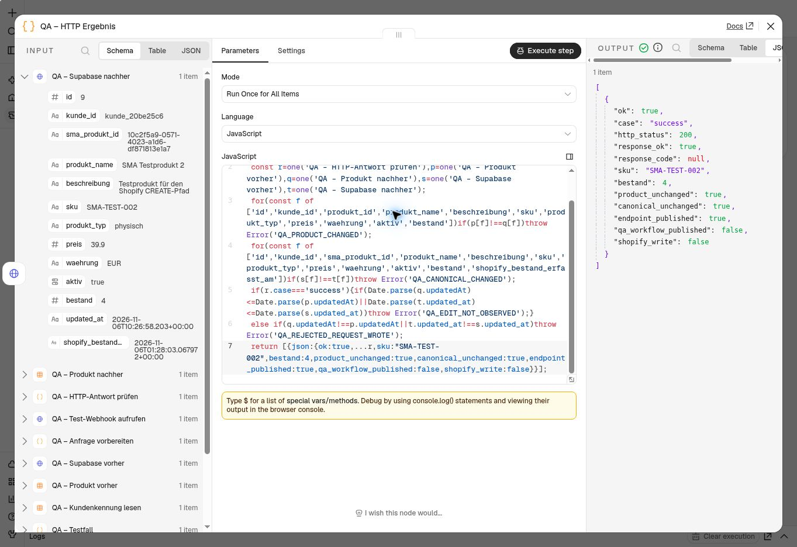

# Bestandsschutz und Produktbearbeitung: produktiv übernommen

Stand: **6. November 2026, 11:31 Uhr Europe/Vienna**.
Beide geprüften n8n-Fassungen sind veröffentlicht. Die vier echten HTTP-Fälle
am aktiven Kundenworkflow sind bestanden. Dieser Bericht ergänzt die
[78 automatisierten Tests und vorherige HTTP-Abnahme](SHOP_PRODUCT_EDIT_RESPONSES.md)
und den [gemeinsamen Bestandsprüflauf](SHOP_INVENTORY_WRITERS.md).

## Aktive Fassungen

| Workflow | Nodes | Veröffentlichte Version |
| --- | ---: | --- |
| Kundenassistent `GHBsYQcyt0JLFvRP` | 534 | `4356cd9c-ecef-4ab0-bdaa-2ed093792379` |
| Bestandsänderungen `JlHOooUl0ySzAV8j` | 42 | `ba4e6069-d0da-4f0c-a67e-000fcac00a62` |

Versionsnamen: **PR81 – Bestandsschutz und bestätigte Produktbearbeitung** bzw.
**PR81 – Bestandsschutz mit Versionsprüfung**. Die Historie kennzeichnet beide
als `Published`; die abschließenden Exporte bestätigen `active:true` und jeweils
dieselbe `activeVersion.versionId`.

Im Hauptworkflow bleiben alle 511 ursprünglichen Node-IDs, Webhook-IDs,
Zugangsreferenzen und Workflow-Einstellungen erhalten. 506 bestehende Nodes
bleiben funktional unverändert, fünf erhalten die geprüften Anpassungen;
23 Nodes werden ergänzt. Bestell-/Teststatus, Authentifizierung, Paketprüfung
und ursprüngliche Shopify-Produktmutationen bleiben unverändert.
Im separaten Bestands-Webhook ändern sich genau vier der 42 Nodes.
Verbindungen, IDs, HMAC-Prüfung und Registrierung bleiben dort unverändert.

Vor Veröffentlichung wurden alle Node-Parameter, Typversionen,
Ausführungsoptionen und Verbindungen mit den geprüften Kandidaten verglichen.
Der Vergleich normalisiert nur explizite/ausgelassene n8n-Standardwerte,
leere terminale Verbindungen und Layoutpositionen. Neue Nodes erhalten UI-IDs;
die ursprünglichen IDs werden separat auf Identität geprüft. Einzelne Positionen
wurden für das Verdrahten angeordnet. Anschließend stimmen die Rückexporte der
aktiven Versionen bei Nodes, Verbindungen und Einstellungen exakt mit den vor
Veröffentlichung geprüften gespeicherten Fassungen überein. Keine gepinnten Daten.

## Ursprünglicher Entwurf erhalten

Vor dem Eingriff wurde der ursprüngliche 515-Node-Entwurf separat dupliziert:

- Workflow `jmdriq3t3UywYnxR`.
- Name: **SICHERUNG – Originalentwurf 515 – vor PR81 – 2026-11-06**.
- Inaktiv und unveröffentlicht, keine Ausführung.

n8n erzeugt beim Duplizieren neue Node-/Webhook-IDs und isolierte Webhook-Pfade.
Der Rückexport weist 515 neue Node-IDs, 45 neue Webhook-IDs und 30 neue Pfade aus;
alle übrigen Node-Konfigurationen, Verbindungen und Einstellungen sind erhalten.
Die Sicherung ist daher kein identischer Ersatz für die aktiven Webhook-URLs.
Die ursprüngliche Fassung `5927ba8a-b235-42cc-b13f-abf800a3e146` ist außerdem in
der Versionshistorie vorhanden; der Tarif begrenzt deren Zugriff auf fünf Tage.
Der exakte private Originalexport wurde für den Abgleich aufbewahrt. Private
Gesamtexporte mit Zugangskonfigurationen werden nicht ins Repository aufgenommen.

## Prüfung am produktiven Endpunkt

Der vorhandene manuelle Prüfer `ZdOzmjZINZtIC03U` ruft nun den bestehenden
Produktivpfad `/webhook/sma-produkt-bearbeiten` auf. Er liest den Kundentoken
intern und kontrolliert beide Speicher vor und nach jedem Aufruf. Die vier
Fälle sind auf das vorhandene Testprodukt `SMA-TEST-002` und den bestätigten
Ausgangsbestand vier begrenzt. Es wurden keine Shopify-Schreibaufrufe ausgeführt.

| Fall | Tatsächliche Antwort | Prüfung beider Speicher |
| --- | --- | --- |
| Ungültiger Kundenzugang | 403, `ok:false` | Inhalt und Änderungszeitpunkte unverändert |
| Gültiger Zugang, unbekanntes Produkt | 404, `ok:false` | Inhalt und Änderungszeitpunkte unverändert |
| Direkte Shopify-Mengenänderung von vier auf drei | 409, `SHOPIFY_STOCK_USE_STOCK_ORDER` | Vor dem Write abgewiesen; Inhalt und Änderungszeitpunkte unverändert |
| Unveränderte Produktbearbeitung | 200, `ok:true` | Beide Änderungszeitpunkte neu; Metadaten und Bestand unverändert |

Die unabhängige Supabase-Abfrage um **10:31:08 UTC / 11:31:08 Wiener Zeit** bestätigt:

- Bestand: **4**.
- Metadatenänderungszeitpunkt: `2026-11-06T10:26:58.203Z`.
- Shopify-Bestandserfassung unverändert: `2026-11-06T01:28:03.067972Z`.
- **22** Bestandsmeldungen `done`, **0** aktive Sperren.

Der abschließende Rückexport des elf Nodes umfassenden Prüfers bestätigt:
inaktiv/unveröffentlicht, nur manueller Einstieg, 90 Sekunden Timeout,
keine Speicherung manueller, erfolgreicher oder fehlgeschlagener Ausführungen,
kein MCP-Zugriff. Gegenüber der vorherigen HTTP-Abnahme ändern sich nur die
Ziel-URL und die getrennten Ergebnisfelder `endpoint_published:true` und
`qa_workflow_published:false`. Der letzte ausgewählte Fall ist `success`.
Die vorherige 21-Node-Empfängerkopie bleibt inaktiv und wartet auf keinen Testaufruf.

[Bereinigter maschinenlesbarer Abschlussnachweis](evidence/shop-inventory-rollout-pr81.json)

## Grenzen und Fortsetzung

Dieser Schritt ist abgeschlossen. Der anschließende Kundenweg im vorhandenen
Shop-Manager ist inzwischen für einen unveränderten Bestand geprüft:
[Bestandsauftrag und bestätigte Dashboard-Anzeige](SHOP_STOCK_REQUEST_E2E.md).
Der Shop-Manager verwendet Supabase und Bestandsaufträge; er ruft den hier
zusätzlich geprüften älteren Bearbeitungsendpunkt nicht auf. Die UI-Abnahme und
die dabei gefundene Bestätigungskorrektur sind im separaten Bericht dokumentiert.

Die Aktivierung des Bestands-Webhooks ist durch Exportabgleich bestätigt.
Seine geänderten Prüf-Nodes wurden zuvor im gemeinsamen echten QA-Lauf ausgeführt;
nach dem Rollout wurde kein neuer Shopify-Bestandsevent oder Kauf erzeugt.
Ein möglicher 502-/Versionskonflikt bleibt ein expliziter Fehler. Es gibt keine
verteilte Transaktion oder automatische Reparaturschleife; Wiederaufnahme muss
frisch lesen und darf keinen alten Write blind wiederholen.

Shopify Payments bleibt im Testmodus. Keine Bestellung, Shopify-Mutation,
Social-Media-Veröffentlichung, Tarifänderung, neue Berechtigung oder SQL-Migration.
