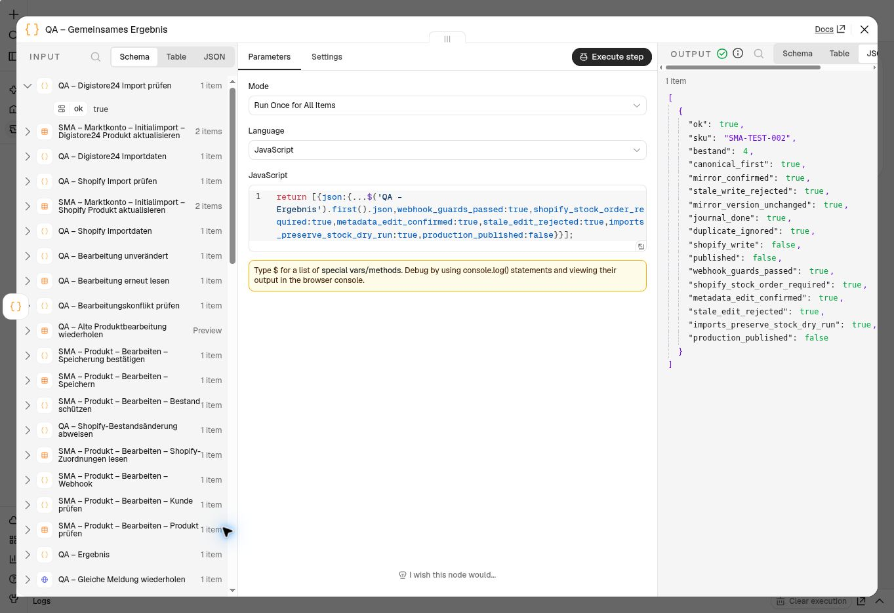

# Gemeinsamer Bestandsschutz der Schreibwege

Stand: 6. November 2026, Europe/Vienna. **63 Tests und gemeinsamer echter n8n-Prüflauf
bestanden. Keine produktive Übernahme.**

## Abgeglichene Quellen

Der separate veröffentlichte Bestands-Webhook wurde frisch exportiert:
`JlHOooUl0ySzAV8j`, Version `c7f4e2c7-a48c-4856-bda6-3b6bff5cb826`, 42 Nodes.
Er enthielt noch drei Identitätsfilter ohne Zeilenversion. Außerdem akzeptierte
seine Übernahmeprüfung bisher auch `applied:false` und prüfte den serverseitigen
Erfassungszeitpunkt nicht. Registrierung, Signaturprüfung und Zugangskonfiguration
wurden nicht verändert.

Die Kundenworkflow-Basis bleibt die abgeglichene veröffentlichte 511-Node-Version
`68d295c6-c07f-4fdc-8395-528d4a92b3d6`. Der erhaltene 515-Node-Originalentwurf
wurde nicht bearbeitet. Details zur Auswahl dieser Basis stehen in
[SHOP_INVENTORY_INTEGRATION.md](SHOP_INVENTORY_INTEGRATION.md).

## Änderungen im privaten Kandidaten

| Schreibweg | Korrektur |
| --- | --- |
| Separater Bestands-Webhook | Bindet Produktzeile und `updatedAt` an die aktuelle Sperre; verlangt `applied:true`, exakte Menge und Erfassungszeit; Tabellen-Update prüft die Zeilenversion; leere Rückmeldung beendet den Lauf mit einem Konflikt. |
| Produktbearbeitung | Liest alle Shopify-Zuordnungen des Produkts. Für ein bereits extern angelegtes Shopify-Produkt ist eine abweichende Menge nur über den bestehenden Bestandsauftrag zulässig. Das gilt auch bei pausierter Zuordnung oder noch fehlender Variantenkennung. |
| Produktbearbeitung bei parallelen Änderungen | Zeilen-ID und `updatedAt` ergänzen die Kunden-/Produktfilter. Erst die bestätigte neue Zeilenversion führt zur bisherigen Supabase-Spiegelung und Erfolgsmeldung. |
| Eigene SMA-Produkte ohne externe Shopify-Zuordnung | Behalten die manuelle Bearbeitung gültiger, nicht negativer ganzer Bestände. |
| Erneuter Shopify- und Digistore24-Initialimport | Aktualisiert bei bestehenden Produkten nur Metadaten. Das Bestandsfeld entfällt aus beiden Updates; erste Inserts bleiben unverändert. |

Damit wird der bereits vorbereitete 524-Node-Kandidat um drei Prüf-Nodes auf
**527 Nodes** ergänzt. Gegenüber der veröffentlichten Basis bleiben 507 Nodes
vollständig unverändert; vier bestehende Nodes werden geändert und 16 ergänzt.
Der separate Webhook bleibt bei 42 Nodes; vier davon erhalten den neuen Schutz.
Die [bereinigte Änderungsübersicht](evidence/shop-inventory-writers-pr81.json)
führt alle betroffenen Namen auf. Parameter- und Verbindungsfingerabdrücke
verhindern eine stille Anwendung auf abweichende Ausgangsversionen.

Supabase und Data Tables bleiben getrennte Systeme. Ein Konflikt ist kein
Erfolg und wird nicht durch blindes Wiederholen eines alten Writes repariert.
Ein vollständiger Neustart muss frisch lesen; eine automatische Reparaturschleife
ist weiterhin nicht implementiert. Diese Änderungen werden erst nach dem
gemeinsamen Echtlauf und dem Abgleich der dann aktuellen Fassungen ausgerollt.

## Prüfung

```sh
node --test tests/inventory-writers.test.cjs tests/inventory-draft.test.cjs \
  tests/inventory-integration.test.cjs tests/shop-stock.test.cjs

git diff --check

node n8n/patch-inventory-writers.cjs webhook WEBHOOK_PRIVATE.json NEW_WEBHOOK_PRIVATE.json
node n8n/patch-inventory-writers.cjs main INTEGRATION_PRIVATE.json NEW_MAIN_PRIVATE.json
node n8n/build-inventory-writers-qa.cjs PUBLISHED_PRIVATE.json WEBHOOK_PRIVATE.json \
  DRAFT_PRIVATE.json NEW_QA_PRIVATE.json
```

**63 Tests bestanden**, darunter die tatsächlich erzeugten Webhook-Code-Nodes,
Ablehnung veralteter/unklarer Antworten, Shopify-Bestandsführung, weiterhin
zulässige SMA-Bearbeitung, alle vier Update-Filter, unveränderte übrige Felder,
unveränderte Routen außerhalb des Eingriffs sowie ein vollständig verbundener
57-Node-Prüfablauf ohne externe Trigger oder Shopify-Mutationen.

Die gemeinsame QA-Kopie benutzt die tatsächlichen geänderten Webhook-Prüfungen
mit den bereits vorhandenen echten Lese-/Sperr-/Übernahmeaufrufen. Danach folgen
eine mengenunveränderte Produktbearbeitung, deren Wiederholung mit alter
Zeilenversion und ein frischer Kontrollabruf. Beide Import-Nodes laufen
**ausschließlich mit `dryRun:true`**: Ein fiktiver Importbestand null darf den
bestehenden Bestand vier in den Vorher-/Nachher-Ergebnissen nicht verändern.
Die Digistore24-Vorschau darf hierbei nur simulieren, niemals die Produktart des
Shopify-Testprodukts speichern.

## Gemeinsamer Echtlauf bestätigt

Die bestehende unveröffentlichte QA-Arbeitskopie `iVy7hpNBjDLxV1Ro` enthält die
aktuelle 57-Node-Fassung einschließlich des Schutzes für Shopify-Produkte mit
noch fehlender Variantenkennung. Der abschließende Rückexport bestätigt alle
Parameter, Code, Zugänge, Verbindungen und Datenschutzeinstellungen: 90 Sekunden
Timeout, keine Speicherung manueller Ausführungen, nicht veröffentlicht.

Der gemeinsame Lauf wurde nach Wiederherstellung der vorübergehend ausgefallenen
Browserverbindung erfolgreich abgeschlossen. Eine neue Anmeldung war nicht nötig.
Die n8n-Oberfläche bestätigt `Workflow executed successfully`; der End-Node zeigt:

| Prüfung | Ergebnis |
| --- | --- |
| Webhook-Prüfungen mit echter Sperre und Supabase-Übernahme | Bestanden. |
| Bestands-Write mit alter Zeilenversion | Abgewiesen; Bestand und Version bleiben unverändert. |
| Direkte Änderung eines Shopify-Bestands über Produktbearbeitung | Vor dem Write abgewiesen; Bestandsauftrag erforderlich. |
| Mengenunveränderte Produktbearbeitung | Gespeichert und bestätigt. |
| Wiederholung der alten Produktbearbeitung | Abgewiesen; frischer Abruf bestätigt unveränderten Stand. |
| Shopify-Import mit fiktivem Bestand null | Vorschau erhält Bestand vier. |
| Digistore24-Import mit fiktivem Bestand null | Vorschau erhält Bestand vier; kein Schreiben der simulierten Produktart. |
| Journalabschluss und identische Wiederholung | `done`, danach `duplicate` / `done`. |

Supabase-Abschlussprüfung vom **6. November 2026, 02:28 Uhr Wiener Zeit**:

- Testprodukt weiter vier Stück.
- **22 abgeschlossene Meldungen**, null aktive Sperren.
- Neue Meldung `2b56722e-8792-50d2-a5f3-93285c691660`: ein Versuch,
  Erfassung `01:28:03.067972Z`, abgeschlossen `01:28:03.959874Z`.



## Verbleibende Übernahme

Die geänderten Schreibwege sind gemeinsam in der getrennten QA-Kopie geprüft.
Der vollständige 527-Node-Kundenworkflow und der 42-Node-Bestands-Webhook liegen
weiterhin als private Integrationskandidaten vor. Vor ihrer produktiven Übernahme
folgen der aktuelle Versionsabgleich und die Abnahme des vollständigen
angemeldeten Kundenablaufs einschließlich seiner Antworten. Der manuelle
Prüflauf ersetzt keinen Test dieses äußeren Authentifizierungs-/Webhook-Einstiegs.

Die aktiven Workflows, der separate Originalentwurf und Shopify Payments im
Testmodus bleiben erhalten. Es gab keine Bestellung, Shopify-Mutation,
kostenpflichtige Änderung oder Änderung der Datenbankrechte.
