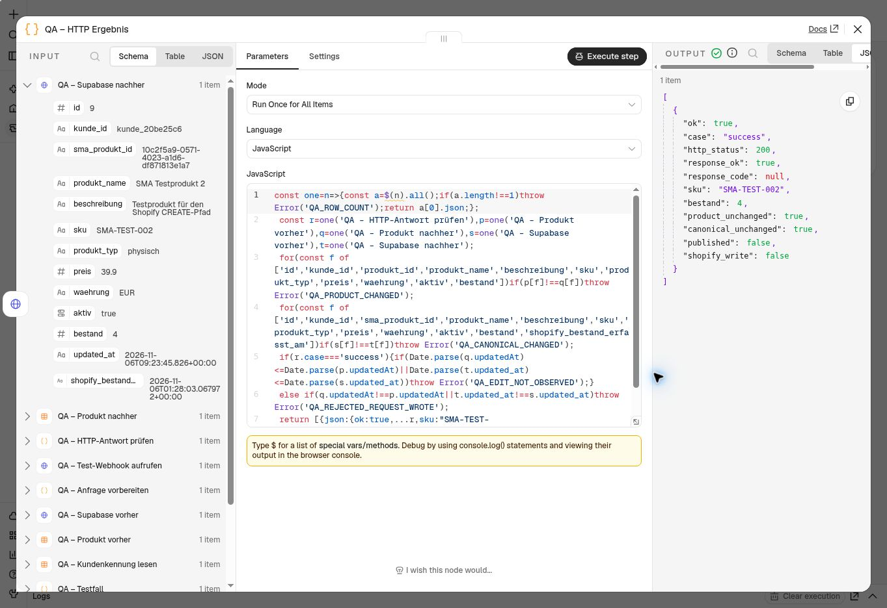

# Produktbearbeitung: bestätigte Speicherung und klare Antworten

Stand: 6. November 2026, 10:27 Uhr Europe/Vienna. **78 automatisierte Tests und
vier echte HTTP-Fälle mit bestehender Kundenauthentifizierung bestanden.** Der
534-Node-Gesamtkandidat ist nicht importiert oder veröffentlicht; der äußere
Bearbeitungsweg wurde in einer getrennten, eng begrenzten Testkopie abgenommen.

## Behobene Lücke im Kandidaten

Nach der bestätigten Data-Table-Bearbeitung liefen die Supabase-Spiegelung und
die Erfolgsmeldung bisher vom selben Ausgang ab. Die Erfolgsmeldung war dadurch
nicht ausdrücklich von einer geprüften Supabase-Rückgabe abhängig. Die neuen
Bestands-/Versionskonflikte hätten außerdem nur den allgemeinen n8n-Fehler
ausgelöst.

`n8n/patch-inventory-edit-responses.cjs` wird nach dem bisherigen
[Bestandsschutz der Schreibwege](SHOP_INVENTORY_WRITERS.md) angewendet:

- Bekannte Eingabefehler und Konflikte erhalten gezielte Antworten. Unerwartete
  Identitäts-, Konfigurations- und Programmfehler werden nicht als Erfolg behandelt.
- Vor dem ersten Write wird die vorhandene Supabase-Kundenzuordnung über denselben
  Zugang gelesen. Genau eine Zuordnung muss zur authentifizierten n8n-Kundenkennung
  passen. Das berücksichtigt die bestehenden unterschiedlichen Kundenkennungen
  in n8n und Supabase, ohne Rechte oder Datenbankfunktionen zu ändern.
- Die Data-Table-Bearbeitung behält ihre vier gemeinsamen Identitäts-/Versionsfilter.
  Erst eine bestätigte neue Zeilenversion erreicht die Supabase-Spiegelung.
- Shopify-Metadaten senden **kein Bestandsfeld** an Supabase. Dadurch können sie
  auch dann keinen alten Bestand zurückschreiben, wenn inzwischen ein neuer
  kanonischer Bestand vorliegt. Für reine SMA-Produkte bleibt das Bestandsfeld erhalten.
- Erfolg folgt ausschließlich nach einer einzelnen, passenden Supabase-Rückgabe:
  Kundenkennung, Benutzerkennung, Produktkennung und alle gesendeten Metadaten
  müssen stimmen. Ein SMA-Bestand muss ebenfalls passen. Ein neuerer bestätigter
  Shopify-Bestand darf von der zuvor gelesenen n8n-Menge abweichen.
- Leere, widersprüchliche oder fehlgeschlagene Supabase-Rückgaben führen zu einer
  festen Fehlermeldung ohne Providerdetails. Beide HTTP-Nodes haben 15 Sekunden
  Timeout und keine automatischen Wiederholungen.

| Fall | HTTP-Antwort |
| --- | --- |
| Kein freigeschalteter Kundenzugang | Bestehende 403-Antwort unverändert |
| Produkt nicht im Kundenbestand gefunden | Bestehende 404-Antwort unverändert |
| Ungültige Bestandsmenge | 400, `PRODUCT_EDIT_STOCK_INVALID` |
| Shopify-Bestand direkt in der Produktbearbeitung ändern | 409, `SHOPIFY_STOCK_USE_STOCK_ORDER` |
| Produktzeile wurde inzwischen geändert | 409, `PRODUCT_EDIT_CONFLICT_RELOAD_REQUIRED` |
| Supabase-Spiegelung fehlt oder ist nicht bestätigt | 502, `PRODUCT_EDIT_MIRROR_NOT_CONFIRMED`, neu laden und gespeicherten Stand prüfen |
| Beide Speicherschritte bestätigt | Bestehende 200-Erfolgsmeldung |

Eine 502-Antwort bedeutet keinen Rollback: Der Data-Table-Schritt kann bereits
gespeichert sein. Es gibt weiterhin keine verteilte Transaktion oder automatische
Reparaturschleife. Der Kunde muss frisch lesen, bevor er erneut bearbeitet.

## Umfang und Nachweise

Der neue Kandidat hat **534 Nodes**: drei Nodes des bisherigen 527-Node-Kandidaten
werden geändert und sieben ergänzt. Gegenüber der veröffentlichten 511-Node-Basis
bleiben 506 Nodes vollständig unverändert; insgesamt werden fünf bestehende Nodes
geändert und 23 ergänzt. Authentifizierung, Paketprüfung, bisherige 403-/404-/200-
Antworten, vorhandene Zugangsreferenzen und Workflow-Einstellungen bleiben erhalten.
Der separate 42-Node-Bestands-Webhook und die geprüfte 57-Node-QA-Kopie sind unverändert.

Der [bereinigte Abgleichbericht](evidence/shop-product-edit-responses-pr81.json)
enthält die betroffenen Namen und Quellenprüfsummen. Private Gesamtexporte gehören
nicht ins Repository. Parameter, Typversionen, Ausführungsoptionen und Verbindungen
werden vor der Transformation gegen den erwarteten Stand geprüft; abweichende,
deaktivierte, doppelte oder gepinnte Quellen werden zurückgewiesen.

```sh
node n8n/patch-inventory-edit-responses.cjs \
  WRITERS_PRIVATE.json NEW_RESPONSES_PRIVATE.json

node n8n/build-inventory-edit-http-qa.cjs \
  WRITERS_PRIVATE.json NEW_ENDPOINT_PRIVATE.json NEW_CALLER_PRIVATE.json

node --test tests/inventory-edit-http-qa.test.cjs tests/inventory-edit-responses.test.cjs \
  tests/inventory-writers.test.cjs tests/inventory-draft.test.cjs \
  tests/inventory-integration.test.cjs tests/shop-stock.test.cjs
git diff --check
```

**78 Tests bestanden.** Elf Antworttests führen die erzeugten Code-Nodes,
Ausdrücke und tatsächlichen Verbindungen mit simulierten Data-Table-/HTTP-Antworten
aus. Sie prüfen Zugangssperren, Produktabgrenzung, 400-/409-Antworten vor Writes,
Kundenzuordnung, beide Speicherbestätigungen, neueren Shopify-Bestand sowie leere,
fehlerhafte und fremde Supabase-Rückgaben. Vier weitere Tests prüfen die Begrenzung
des HTTP-Prüfaufbaus, unveränderte Ausgangsdaten, die vier Fälle und die getrennte
Bestätigung beider Speicher. Diese automatisierten Tests sind Simulationen;
die folgenden vier Fälle wurden zusätzlich tatsächlich über HTTP ausgeführt.

## Echter HTTP-Kundenweg bestätigt

Die erneut angeforderte sichere n8n-Anmeldung war erfolgreich und blieb während
der Arbeit bestehen. Beide Ausgangsfassungen wurden frisch exportiert:
511 veröffentlichte Nodes und 515 erhaltene Entwurfs-Nodes, jeweils identische
Nodes, Verbindungen und Einstellungen zur gesicherten Fassung.

Der Generator erstellt zwei separate, unveröffentlichte Prüfkopien:

- Empfänger `lLeZX1N8wy83psGS`, **21 Nodes**: tatsächlicher Bearbeitungsweg mit
  bestehendem Kundentoken und Paketprüfung; zusätzliche Einschränkung auf
  `kunde_3182` und `SMA-TEST-002`. Ein zusätzlicher Guard erlaubt ausschließlich
  unveränderte Metadaten und den bestätigten Bestand vier. Eindeutiger Testpfad,
  jeweils nur vorübergehend über „Execute workflow“ erreichbar.
- Aufrufer `ZdOzmjZINZtIC03U`, **11 Nodes**: ein manueller Einstieg. Er liest den
  bestehenden Kundentoken intern, prüft zuerst übereinstimmende Ausgangsdaten,
  ruft den Testpfad auf und liest anschließend beide Speicher erneut. Der
  Ergebnis-Node gibt nur bereinigte Prüffelder aus. Kein Token wird exportiert,
  ausgegeben oder in der Dokumentation gespeichert.

| Tatsächlicher HTTP-Fall | Antwort | Nachweis nach dem Aufruf |
| --- | --- | --- |
| Absichtlich ungültiger Kundentoken | 403, `ok:false` | Beide Inhalte und Änderungszeitpunkte unverändert |
| Gültiger Token, unbekannte Produktkennung | 404, `ok:false` | Beide Inhalte und Änderungszeitpunkte unverändert |
| Gültiger Token, Shopify-Bestand drei statt vier | 409, `SHOPIFY_STOCK_USE_STOCK_ORDER` | Beide Inhalte und Änderungszeitpunkte unverändert |
| Gültiger Token, unveränderte Produktbearbeitung | 200, `ok:true` | Beide Speicher haben neue Änderungszeitpunkte; Metadaten und Bestand bleiben unverändert |

Die Rückexporte bestätigen die tatsächlich gespeicherten Node-Parameter, Code,
Zugangsreferenzen, Verbindungen und Einstellungen. UI-Defaults wie ausgelassenes
`GET` bzw. Code-Modus und leere terminale Verbindungen wurden beim Vergleich
normalisiert. Beide Kopien: inaktiv, keine Speicherung manueller, erfolgreicher
oder fehlgeschlagener Ausführungen, keine MCP-Freigabe, 90 Sekunden Timeout.
Der Aufrufer enthält zuletzt den Fall `success`; der Empfänger wartet nach
Abschluss nicht mehr auf einen Testaufruf.

Die unabhängige Supabase-Kontrolle um **10:27 Uhr Wiener Zeit** bestätigt:
vier Stück, 22 abgeschlossene Bestandsmeldungen, null aktive Sperren. Die
Metadatenbearbeitung wurde um **10:23:45 Uhr** bestätigt; der kanonische
Shopify-Bestandszeitpunkt bleibt `2026-11-06T01:28:03.067972Z`.

[Bereinigter HTTP-Prüfbericht](evidence/shop-product-edit-http-pr81.json)



## Verbleibende produktive Übernahme

Der äußere Bearbeitungsweg ist jetzt in der isolierten Testkopie geprüft.
Die Übernahme des vollständigen 534-Node-Kundenworkflows und des geänderten
42-Node-Bestands-Webhooks steht noch aus. Vor dem Umschalten sind deren dann
aktuelle Fassungen erneut abzugleichen; der separate Webhook wurde in dieser
Sitzung nicht verändert. Der geschützte 515-Node-Originalentwurf bleibt erhalten.

Es gab keine Veröffentlichung, Shopify-Mutation, Bestellung, kostenpflichtige
Änderung oder Änderung der Datenbankrechte. Shopify Payments bleibt im Testmodus.

Der vorhandene Shop-Manager liest über Supabase und nutzt Bestandsaufträge. Er
ruft diesen älteren n8n-Produktbearbeitungsendpunkt derzeit nicht auf; dieser
Prüfstand ist daher auch keine neue Dashboard-UI-Abnahme.

Technische Referenzen: [n8n Respond to Webhook](https://docs.n8n.io/integrations/builtin/core-nodes/n8n-nodes-base.respondtowebhook)
und [n8n Node-Einstellungen](https://docs.n8n.io/build/understand-workflows/workflow-components/work-with-nodes.md).
