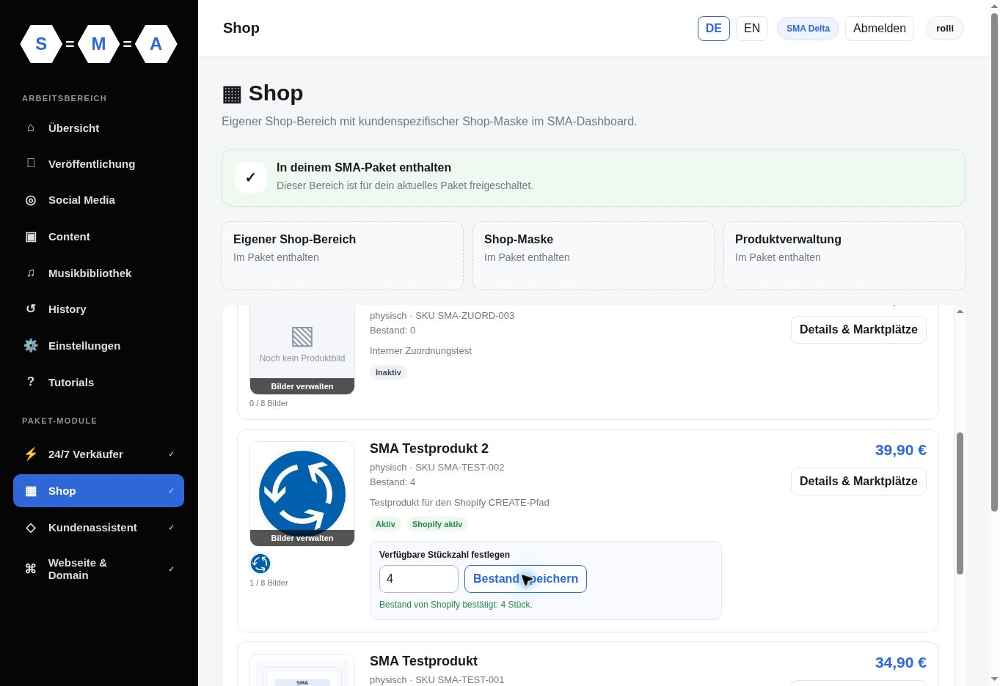

# Bestandsauftrag im angemeldeten Shop-Manager

Stand: **6. November 2026, 12:12 Uhr Europe/Vienna**.

Der echte Kundenweg ist für einen unveränderten Bestand erfolgreich geprüft:
**Bestand speichern → Auftrag → Shopify → bestätigte Rückmeldung im Dashboard**.
Die Prüfung ergänzt den [Rollout aus PR #81](SHOP_INVENTORY_ROLLOUT.md).

## Gefundener Fehler und Korrektur

Beim ersten Auftrag für `SMA-TEST-002` mit **4 → 4** blieb die Anzeige auf
„Shopify-Übernahme wird verarbeitet …“. Der Worker speicherte
`SHOPIFY_CONFIRMATION_MISSING` und `review_required`. Sein bisheriger Ergebniscode
verlangte immer eine `inventoryAdjustmentGroup`. Die Shopify-Schemaantwort erlaubt
jedoch einen null-Wert. Die neue echte Ausführung bestätigte genau diesen Fall
mit leerer Fehlerliste und unverändertem Bestand. Eine fehlende Änderungsgruppe
allein wird weiterhin nicht als Erfolg gewertet.

Im Workflow **SMA – Shopify – Kundenbestand setzen V1** (`LeeH7IigyGRRUuxS`)
folgt auf `Shopify-Bestand setzen` jetzt einmal `Shopify-Bestand nachlesen`.
`Shopify-Ergebnis prüfen` erhält sowohl die ursprüngliche Mutation als auch diese
frische Lesung. Nur bei unveränderter Ausgangs-/Zielmenge, explizit leerer
Fehlerliste und explizit null gesetzter Änderungsgruppe darf die Lesung den Auftrag
bestätigen. Variante, Produkt, SKU, InventoryItem, eindeutiger aktiver
Online-Standort und ganzzahlige verfügbare Menge müssen vollständig passen;
unvollständige Seiten und ein über 90 Sekunden alter Vorbereitungssnapshot
werden abgewiesen. Ein regulär bestätigter Änderungsbeleg behält seinen bisherigen
Erfolg, auch wenn die zusätzliche Lesung fehlschlägt.

Die Shopify-Mutation einschließlich `changeFromQuantity` und
`@idempotent(key: request_id)` ist unverändert. Kein automatischer Schreib-Retry.
Der zusätzliche HTTP-Leseaufruf hat 12 Sekunden Timeout und keinen Retry.
Andere Mengenänderungen ohne eindeutigen Änderungsbeleg bleiben prüfpflichtig.

Schema: [Shopify InventorySetQuantitiesPayload](https://shopify.dev/docs/api/admin-graphql/2026-07/payloads/InventorySetQuantitiesPayload).
Die Dokumentation belegt die nullable Gruppe; sie garantiert nicht ausdrücklich
das Verhalten bei unveränderter Menge. Die Korrektur verlässt sich deshalb auf
die zusätzlich geprüfte Lesung und nicht auf diese Vermutung.

## Aktivierung und Quellenvergleich

- Vorher: 30 Nodes, aktive Version `1f30317b-6eb6-45a0-a1ec-920709f50ba2`.
- Jetzt: 31 Nodes, aktive Version `d602ccc4-4f13-416b-bb8d-15d1b7d6462b`.
- Versionsname: **Bestandsauftrag – unveränderte Menge bestätigt**.
- Genau ein Code-Node geändert, ein vorhandener Lese-Node kopiert und die
  Verbindung zwischen Mutation und Ergebnisprüfung über diese Kopie geführt.
- Alle 30 ursprünglichen Node-/Webhook-IDs, die übrigen 29 Nodes und die
  Einstellungen erhalten. Keine gepinnten Daten und keine neue Berechtigung.

Der gespeicherte Rückexport wurde vollständig mit dem lokal geprüften Kandidaten
verglichen. Normalisiert wurden n8n-Standardwerte, leere terminale Verbindungen,
Positionen/neue UI-ID sowie zwei reine Einrückungsleerzeichen in der letzten
Code-Fortsetzungszeile. Der anschließende Export aus der veröffentlichten
Versionshistorie stimmt bei allen Nodes, Verbindungen und Einstellungen exakt
mit dieser geprüften gespeicherten Fassung überein; `active:true` und
`activeVersion.versionId` sind bestätigt.

Private vollständige Workflow-Exporte bleiben außerhalb des Repositorys.
Die Test-Fixture enthält nur die für die Änderung erforderlichen Parameter;
Zugangsreferenzen und Webhook-IDs sind entfernt. Der Patch prüft sieben
Quell-Fingerabdrücke und verweigert eine abweichende oder bereits gepatchte Quelle.

## Echte Prüfung

| Prüfung | Ergebnis |
| --- | --- |
| Ausgangsbestand direkt aus Shopify | verfügbar 4, physisch 11, gebunden 7 |
| Erster UI-Auftrag, 10:55:15 UTC | einmal zugestellt; alte Bestätigung unklar |
| Sichere Auflösung, 11:11:34 UTC | frische Shopify-Lesung bestätigte unveränderten Bestand; ursprünglicher Auftrag über vorhandene lease-geprüfte Finish-RPC als fehlgeschlagene Bestätigung abgeschlossen, ohne Mutation erneut auszuführen |
| Neuer UI-Auftrag, 11:12:09 UTC | einmal zugestellt; `applied` um 11:12:11 UTC |
| Bestätigung | `SHOPIFY_UNCHANGED_CONFIRMED`, `confirmation:readback`, Menge 4 |
| Dashboard | „Bestand von Shopify bestätigt: 4 Stück.“; Eingabe wieder freigegeben |
| Abschließende unabhängige Shopify-Lesung | weiterhin verfügbar 4, physisch 11, gebunden 7 |
| Supabase-Produkt | Bestand 4; Metadaten- und Bestandserfassungszeitpunkte unverändert |
| Auftrags-/Bestellkontrolle | keine offenen Bestandsaufträge; weiterhin 10 Bestellungen |

Der erste Auftrag wurde nicht nachträglich als erfolgreich umgeschrieben.
Seine ursprüngliche unklare Antwort, Prüfgrund und Abschlusszeit bleiben erhalten.
Der zweite, nach der Korrektur bewusst neu angelegte UI-Auftrag ist getrennt
nachgewiesen. Jeder Auftrag wurde genau einmal zugestellt.

13 neue Contract-/Patch-Tests und die 10 vorhandenen Shop-Bestandstests bestehen.
Der vollständige lokale Repository-Lauf besteht mit **524 Tests**.

[Bereinigter Prüfbeleg](evidence/shop-stock-request-e2e.json)

## Umfang und nächste Fortsetzung

Der angemeldete Kundenweg und die neue Bestätigung unveränderter Mengen sind
abgeschlossen. Dieser Lauf ändert die tatsächlich verfügbare Menge nicht und
erzeugt daher keinen Nachweis eines neuen Bestands-Webhooks. Der anschließende
separate [Mengenänderungstest 4 → 3 → 4](SHOP_STOCK_ROUNDTRIP_E2E.md) ist inzwischen
ebenfalls abgeschlossen: beide Aufträge und Bestandsmeldungen wurden jeweils
einmal verarbeitet, beide Speicher und das Dashboard aktualisiert und der
Ausgangsbestand wiederhergestellt.

Shopify Payments bleibt im Testmodus. Keine Bestellung, Zahlung, Tarifänderung,
Social-Media-Veröffentlichung oder SQL-Migration. Die beiden PR-81-Workflows und
der separate unveröffentlichte Originalentwurf wurden nicht verändert.
