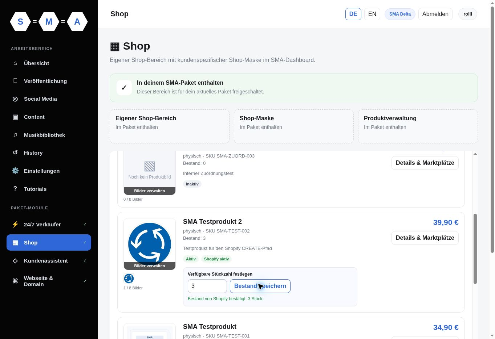
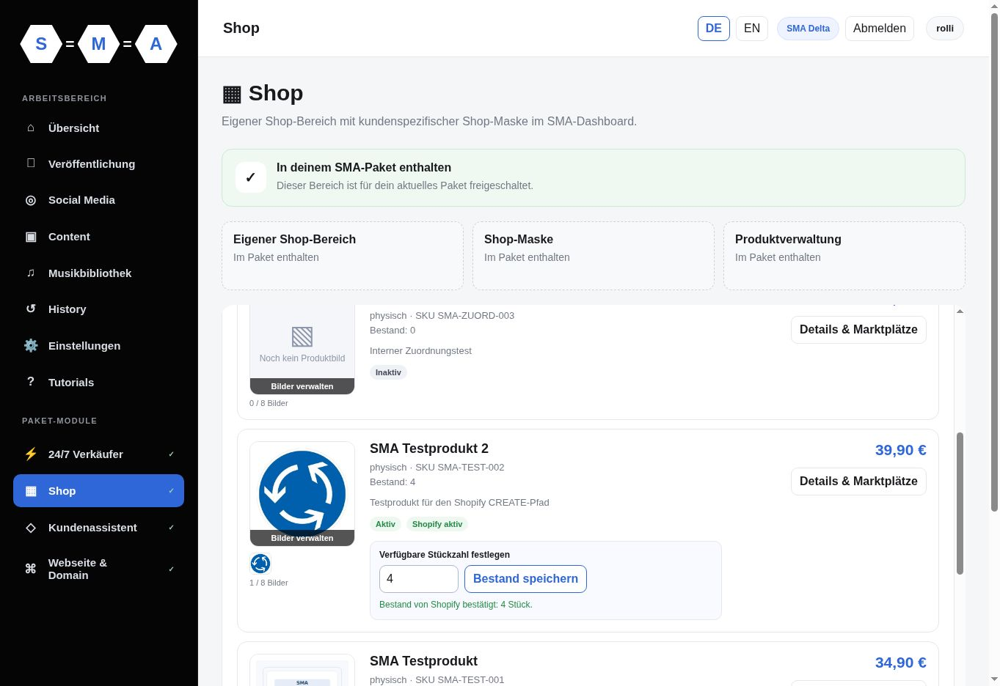
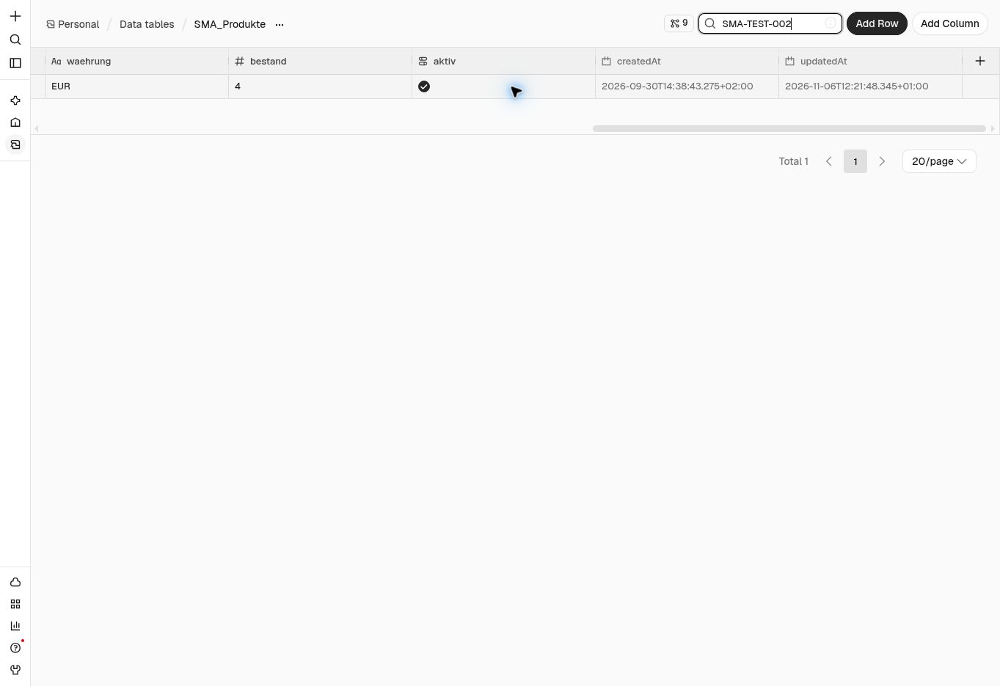

# Bestandskreislauf 4 → 3 → 4 abgeschlossen

Stand: **6. November 2026, 12:22 Uhr Europe/Vienna**.

Der Kundenweg für eine echte Mengenänderung ist durchgängig geprüft:
**Dashboard → Bestandsauftrag → Shopify → Bestands-Webhook → Supabase und
n8n-Produktspiegel → aktualisiertes Dashboard**. Der Ausgangsbestand wurde
vollständig wiederhergestellt. Damit ist der nach
[PR #82 noch offene Mengenänderungstest](SHOP_STOCK_REQUEST_E2E.md) abgeschlossen.

## Kontrollierter Ablauf

Der Test betrifft ausschließlich das vorhandene Produkt `SMA-TEST-002`.
Vor dem ersten Auftrag bestätigten eine unabhängige Shopify-Lesung und Supabase
vier verfügbare Stück. Es gab keine offenen Bestandsaufträge oder aktiven
Bestandssperren, 22 abgeschlossene Bestandsmeldungen und zehn Bestellungen.

Beide Aufträge wurden über **Bestand speichern** im bereits angemeldeten
Kundendashboard erzeugt. Nach dem ersten Auftrag wurde die vollständige
Rücksynchronisierung abgewartet; erst danach folgte der Rückstellungsauftrag.
Es wurden keine Tabellenwerte manuell korrigiert und keine Workflows geändert.

| Prüfung | 4 → 3 | 3 → 4 |
| --- | --- | --- |
| Auftrag erstellt (UTC) | 11:20:32.154187 | 11:21:40.649553 |
| Shopify-Übernahme bestätigt (UTC) | 11:20:36.868021 | 11:21:42.520044 |
| Auftragsstatus | `applied`, `SHOPIFY_CONFIRMED` | `applied`, `SHOPIFY_CONFIRMED` |
| Auftragszustellungen | 1 | 1 |
| Bestandsmeldung eingegangen (UTC) | 11:20:42.796684 | 11:21:47.624773 |
| Bestandsmeldung abgeschlossen (UTC) | 11:20:43.691437 | 11:21:48.528963 |
| Bestandsmeldung | `done`, 1 Verarbeitung | `done`, 1 Verarbeitung |
| Supabase-Bestand | 3 | 4 |
| Dashboard ohne Neuladen | Bestand 3 und Bestätigung 3 Stück | Bestand 4 und Bestätigung 4 Stück |
| Unabhängige Shopify-Lesung: verfügbar / physisch / gebunden | 3 / 10 / 7 | 4 / 11 / 7 |

Die Bestandsmeldungen sind vollständig abgeschlossen. Im aktiven Webhook erfolgt
dies erst nach erfolgreicher Übernahme in Supabase und bestätigter Spiegelung
in die n8n-Produkttabelle. Zusätzlich wurde die finale n8n-Zeile direkt in
**SMA_Produkte** nach SKU gefiltert gelesen: Bestand **4**, Änderungszeitpunkt
`2026-11-06T12:21:48.345+01:00` (11:21:48.345 UTC).

Der abschließende Supabase-Abgleich bestätigt **24** Bestandsmeldungen `done`,
**0** offene Bestandsaufträge, **0** aktive Sperren und weiterhin **10**
Bestellungen. Gegenüber dem Ausgangspunkt sind genau zwei Bestandsaufträge und
zwei neue Bestandsmeldungen hinzugekommen; beide jeweils einmal verarbeitet.
Dieser Lauf erzeugt keine künstliche Doppelzustellung und ersetzt daher nicht
die bereits dokumentierten Wiederholungs-/Idempotenztests.

## Nachweise

[Bereinigter maschinenlesbarer Prüfbeleg](evidence/shop-stock-roundtrip-e2e.json)

## Abschluss und Grenzen

Bestandsauftrag, Shopify-Änderung, Bestands-Webhook, kanonischer Bestand,
n8n-Spiegel und Kundendarstellung sind für diesen Produkt-/Standortfall
erfolgreich abgenommen. Es ist keine weitere Codekorrektur erforderlich.
Die **524 bestandenen Repository-Tests** aus PR #82 bleiben der unveränderte
Code-Prüfstand; dieser Folgeschritt ergänzt die echten Laufzeitnachweise.

Der Test verwendet einen aktiven Online-Standort und eine eindeutig zugeordnete
Variante. Mehrstandort-, parallele Bestell- und Provider-Ausfallfälle werden hier
nicht als neue echte Tests behauptet. Der ursprüngliche unveröffentlichte
n8n-Entwurf bleibt erhalten. Shopify Payments bleibt im Testmodus; keine
Bestellung, Zahlung, Erstattung, Versandaktion, Tarifänderung oder Veröffentlichung
auf Social Media wurde ausgelöst.
