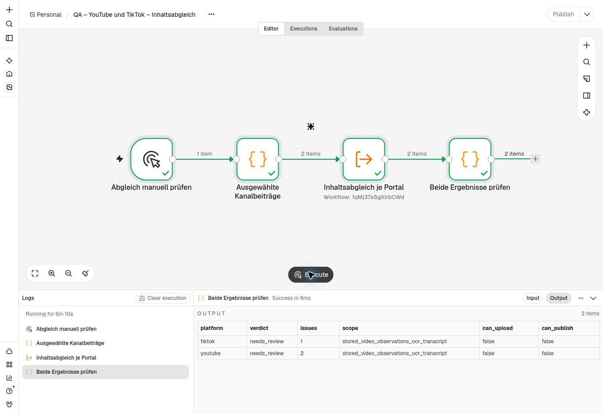

# Gespeicherte Portaltexte gegen Video-Beobachtungen prüfen

Stand 3. November 2026. Für YouTube und TikTok gibt es jetzt einen getrennten internen Inhaltsabgleich. Er vergleicht den tatsächlich gespeicherten Titel und die Caption einschließlich Hashtags mit den vorhandenen Video-Beobachtungen, erkannten Bildtexten und gegebenenfalls dem Transkript. Er erzeugt keinen Ersatztext und bestätigt weder Rechte noch die Sicherheit des vollständigen Videos.

## Live-Stand

| Bestandteil | Ergebnis |
| --- | --- |
| Interner n8n-Unterworkflow | `1qMj37a5gXlrbCWd`, 11 Nodes, nur Execute-Workflow-Einstieg |
| Isolierter manueller Zweikanaltest | `icUFQQBughY8hRb1`, 4 Nodes, beide Ergebnisse vorhanden |
| TikTok | `needs_review`, eine konkrete Rückfrage |
| YouTube | `needs_review`, zwei konkrete Rückfragen |
| Titel und Caption beider Zuordnungen | SHA-256 unverändert gegenüber dem gemeinsamen Dateiabruf |
| Freigegebene Aufträge / Journaleinträge | weiterhin 0 / 0 |

Die Datenbank bestätigt abgeschlossene Modellprüfungen am 03.11.2026 um 19:31:04 und 19:31:25 MEZ, ohne verbleibende Lease. Die letzte QA-Node lieferte zwei Ergebnisse mit `can_upload:false` und `can_publish:false`. Die n8n-Oberfläche zeigte dabei noch einen weiterlaufenden Gesamtzähler; dieser wird ausdrücklich nicht als Laufzeitnachweis verwendet. Fachlicher Nachweis sind die beiden abgeschlossenen Datenbankergebnisse und die erfolgreiche abschließende Prüfnode. Die flüchtige Ausführungsanzeige wurde anschließend geleert.

Bei beiden Texten ist die beschriebene Mechanik anhand der gespeicherten Beobachtungen noch nicht ausreichend belegt; bei YouTube zusätzlich der Hotel-Bezug. Das ist eine Modellrückfrage zu begrenzten Belegen, kein Beweis, dass die Aussage im vollständigen Video falsch ist. Die gespeicherten Beiträge bleiben unverändert. Die konkreten Zitate werden nur im privaten Prüfdatensatz gespeichert.



## Bindung und Freigabegrenzen

`publication-content-comparison.sql` reserviert einen privaten Prüfdatensatz pro SHA-256-Fingerabdruck aus Eigentümer, vollständiger Dateizuordnung, gespeicherten Texten, aktueller Analyse und Prüfpolicy. Vor Start, Abschluss und Anzeige werden die maßgeblichen Daten erneut gelesen. Datei- und Zuordnungsrevisionen, Shop-Ziel, Analysepolicy, Dateiprüfsumme, Dateigröße und frischer Katalogstand müssen passen. Ein geänderter Text oder Beleg erbt kein altes Ergebnis.

Der Start ist auf sechs Versuche pro Eigentümer und Stunde begrenzt. Eine vierminütige Lease bindet den Abschluss. Ein bereits versuchter Fingerabdruck wird nicht automatisch kostenpflichtig wiederholt; ein abgeschlossenes Ergebnis wird aus dem Cache gelesen. Das Modell darf ausschließlich ein geschlossenes Ergebnisschema mit exakten Zitaten aus den gespeicherten Texten liefern. Unvollständige Antworten, fremde Zitate, unbekannte Felder und modellseitige Freigaben werden zurückgewiesen. Fehler werden ohne rohe Providerantwort gespeichert.

Die bestehenden Medienchecks werden ausschließlich im konkreten Auftrag um `PORTAL_TEXT_COMPARISON` ergänzt. Bei Rückfragen bleibt er `pending`; ein passender Text kann hier `pass` erhalten. `SEMANTIC_REVIEW_PENDING`, `CONTENT_REVIEW_PENDING`, sämtliche Rechtebestätigungen und die finale Zustimmung bleiben unabhängig davon bestehen. Der vorhandene Dialog zeigt offene Rückfragen über seinen bestehenden Text-Renderer. Keine Änderung an UI-Code, Schrift oder CSS.

Die Projektion wurde mit den beiden echten aktuellen Bindungen nach einem erfolgreichen Dashboard-Katalogabgleich um 19:38 MEZ geprüft: aktueller Kontext, unveränderte Titel-/Caption-Prüfsummen und sowohl neuer Hinweis als auch bisherige Medienblocker vorhanden. Für diese Prüfung wurde kein neuer Kundenauftrag angelegt. Eine erneute visuelle Abnahme des Auftragsdialogs ist damit nicht behauptet.

## Betrieb und Reproduktion

Die neue Modellstrecke ist eine gespeicherte, unveröffentlichte interne Kopie ohne öffentlichen Webhook. Sie ist noch nicht automatisch in die Auftragsvorbereitung eingehängt. Der bestehende Auftragsworker hat ein kürzeres Zeitfenster; eine sichere asynchrone Ansteuerung ist ein eigener verbleibender Schritt. Die gespeicherten Ergebnisse werden bereits durch die installierte Auftragsprojektion gelesen.

```sh
python3 n8n/publishing/build-content-comparison.py
python3 n8n/publishing/build-content-comparison-rehearsal.py \
  --input /private/selected-bindings.json \
  --workflow-id 1qMj37a5gXlrbCWd \
  --output /private/content-comparison-qa.json
node --test tests/*.test.cjs
node tests/run-publication-comparison-sql.mjs
node tests/run-publication-accounts-sql.mjs
```

Bei Neuinstallation zuerst die vorhandenen Datei-, Analyse- und Kontodefinitionen, danach `publication-content-comparison.sql`, dann `publication-orders.sql` installieren. Live angewendet: `publication_stored_content_comparison_20261103` und `publication_comparison_order_projection_20261103`. Vor der Änderung war der Funktionsrumpf von `publication_order_media_v1` exakt gleich dem vorherigen Repositorystand. Nur diese vorhandene Funktion wurde für die Projektion ersetzt; sonst additive Funktionen und private Tabelle.

Die beiden Abschlussexporte wurden gegen die Generatoren geprüft: gleiche Nodeparameter, Code, Credential-Referenzen und Verbindungen; n8n entfernt beim Execute-Workflow-Node das Standardfeld `source:database` und erneuert IDs/Positionen beim Import. Beide Kopien sind `active:false`, ohne Pins oder Ausführungsdatenspeicherung, ohne Fortschrittsspeicherung, nur gleicher Eigentümer, MCP aus; Zeitlimits 210 beziehungsweise 450 Sekunden. Die Vorlagen verwenden die bereits vorhandenen OpenAI-/Supabase-Verbindungen. Es gab keine neue Berechtigung oder Tarifänderung.

Validierung: **301 Node-Tests bestanden**. Vergleichs-, Konto-, Auftrags- und Creator-SQL-Prüfreihen bestanden lokal unter PGlite/PostgreSQL 18; Vergleichs-, Auftrags- und Creator-Fälle zusätzlich auf der produktiven PostgreSQL-17-Instanz mit synthetischen, zurückgerollten Fixtures. Rollenrechte, geänderte Belege/Texte, falsche Leases, Wiederholungen, exakte Zitate und unveränderte Medienblocker sind abgedeckt. Keine neue Sicherheitsberater-Warnung. Für die absichtlich service-interne Tabelle entsteht derselbe INFO-Hinweis „RLS Enabled No Policy“ wie bei den übrigen privaten Servicetabellen; Kundenrollen besitzen keine Tabellen- oder Funktionsrechte. [Hinweisbeschreibung](https://supabase.com/docs/guides/database/database-linter?lint=0008_rls_enabled_no_policy).

Sightengine bleibt bei `VIDEO_PLAN_REQUIRED`. Vollständige visuelle Sicherheitsprüfung, ausdrückliche Nutzerfreigabe, automatische asynchrone Vergleichsansteuerung und tatsächlicher Providerbetrieb bleiben offen. Meta und Serverumbau bleiben außerhalb dieses Schritts. Zur vorbereiteten Upload-/Ergebnisauswertung: [PROVIDER_RESULTS.md](PROVIDER_RESULTS.md).

## Automatische Auftragsansteuerung – Fortsetzung PR #57

Die additive Migration `publication_comparison_delivery_v1` ist installiert. Neue YouTube-/TikTok-Videoaufträge legen ihre Abgleichaufgabe in derselben Transaktion an. Der vorhandene Vergleichscache bleibt maßgeblich. Eine Queue-Lease verhindert parallele Zustellung; verlorene Starts vor dem Modellaufruf sind bis zu dreimal zustellbar. Die vorhandene Vergleichsreservierung verhindert einen zweiten kostenpflichtigen Modellversuch für denselben Fingerabdruck. Ein neuer Belegfingerabdruck erhält einen eigenen Abgleich; alte Ergebnisse oder Leases werden nicht übernommen. Stornierte Aufträge werden nicht verarbeitet.

`comparison-delivery-workflow.json` ist als private Kopie **`ZFO9NSh5nHSn3ues`** importiert. Die vorbereitete API-Vorlage stößt sie nach erfolgreichen Auftragsantworten ohne Warten an. Auch ein erneutes `get` kann einen verlorenen Start zustellen. Fehler beim Start verändern die ursprüngliche Dashboard-Antwort nicht. Es wird kein zusätzlicher Zeittrigger eingerichtet.

**Noch nicht live angeschlossen:** Der Nutzer hat das Speichern von „keine Ausführungsdaten speichern“ und 270 Sekunden Zeitlimit ausdrücklich freigegeben. Der anschließende n8n-Zugriff scheiterte an Zeitüberschreitungen der Browsersteuerung; auch deren Zurücksetzen war nicht erreichbar. Das Speichern ist deshalb nicht nachgewiesen. Die neue Kopie bleibt nach dem letzten bestätigten Stand unveröffentlicht; die aktive API ist unverändert. Vor dem Anschluss die Kopie nochmals mit dem aktuellen Generator abgleichen (einschließlich des korrigierten If-Ausdrucks ohne `.binding` im n8n-Parameter), die bereits freigegebenen Einstellungen speichern und exportieren, anschließend Vergleichsunterworkflow und Delivery-Workflow veröffentlichen und die API-Vorlage übernehmen. Eine erneute Einstellungsfreigabe ist nicht erforderlich. Keine der Vorlagen besitzt einen Social-Media-Schreibpfad.

Die Queue-Prüfung bestand lokal sowie gegen PostgreSQL 17 mit synthetischen Rollback-Fixtures: atomare Auftragseinfügung, exklusive Lease, verlorener Start, falsche/späte Lease, Cacheabschluss, geänderte Belege und Stornierung. 313 Node-Tests bestanden. Kein zusätzlicher echter Modelllauf und kein neuer Kundenauftrag wurden ausgelöst. [Dauerhafte Provider-Ergebnisse und verbleibende Anschlussarbeiten](PROVIDER_RESULTS.md).

```sh
python3 n8n/publishing/build-comparison-delivery.py
python3 n8n/publishing/build-publication-orders.py \
  --worker-id zLlhr1I1vKm2AiiU --account-id LR2Qng41OIYuVHAR \
  --comparison-delivery-id ZFO9NSh5nHSn3ues
node tests/run-publication-delivery-sql.mjs
```
